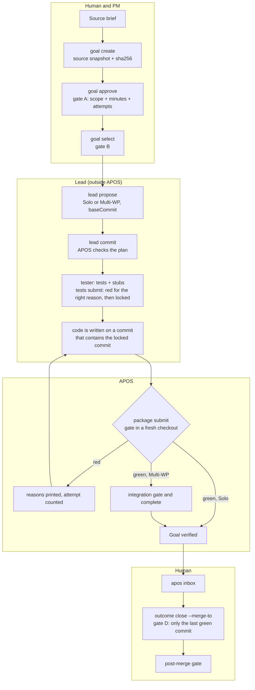

<div align="center">


<br />

**An assurance layer for AI-built software. It runs fixed checks on the commits an agent hands over and records the result. It never takes anyone's word for it, not even an LLM's.**


[**Quick start**](#quick-start) · [**How it works**](#how-it-works) · [**Web UI**](#web-ui) · [**Trust model**](#trust-model) · [**CLI reference**](#cli-reference) · [**Roadmap**](#roadmap)

</div>

<br />

| | |
| --- | --- |
| **Humans own the what** | You approve the Goal, its budget and whether to close it. Never the technical plan. |
| **Whoever orchestrates owns the how** | A Lead (an agent, a script, you) plans and gets the code written, with any tool. APOS does not start, wake or watch an agent. |
| **APOS owns the proof** | Output counts only when a check APOS runs itself, on an exact commit, passes. An LLM saying "done" is a claim, never evidence. |
| **Everything is auditable** | Every event lands in an append-only, hash-chained log you can replay and verify. |

---

## Contents

1. [Purpose](#purpose)
2. [How it works](#how-it-works)
3. [Install](#install)
4. [Quick start](#quick-start)
5. [The Goal contract](#the-goal-contract)
6. [Delivery flows](#delivery-flows) (Solo, [a bug](#fixing-a-bug-apos-bug), [an old repo](#an-old-repo-with-few-tests), Multi-WP)
7. [Project setup](#project-setup), [Layers by stage](#layers-by-stage), [The assurance table](#the-assurance-table) and [Web UI](#web-ui)
8. [Configuration and state](#configuration-and-state)
9. [Trust model](#trust-model)
10. [CLI reference](#cli-reference), [Reviews](#reviews), [Mutation](#mutation) and [Demo](#demo)
11. [Old logs (legacy Goals)](#old-logs-legacy-goals)
12. [Development](#development)
13. [Limits](#limits)
14. [Roadmap](#roadmap)

---

## Purpose

Plenty of tools run coding agents. Almost none check that the software they ship does the **right thing** and meets a **quality bar**; most let the LLM answer that question itself. APOS v3 is that check, standing outside any orchestrator:

- A Goal is written from a verbatim source, with every requirement mapped to acceptance criteria and to checks a machine can run.
- Work is delivered as commits. `apos package submit` runs the Goal's checks in a fresh detached checkout of that exact commit, compares failures against the base commit, and records `green`, `red`, `needs-human` or `unverifiable`.
- A Goal is verified only on a green gate, and only the commit of the last green gate can be closed.

LLMs may write code, tests and plans. What an LLM says is never the proof.

Design: [`docs/superpowers/specs/2026-11-22-apos-v3-design.md`](docs/superpowers/specs/2026-11-22-apos-v3-design.md) (Vietnamese). Phase-1 plan: [`docs/superpowers/plans/2026-11-22-apos-v3-dot1.md`](docs/superpowers/plans/2026-11-22-apos-v3-dot1.md). Safety cases: [`docs/fault-injection.md`](docs/fault-injection.md).

## How it works

| Who | Decides | Commands |
| --- | --- | --- |
| **PM + Human** | WHAT: which Goals, outcome, acceptance, budget | `goal create --source`, **gate A** `goal approve` |
| **Human** | Which approved Goal is worked next | **gate B** `goal select` |
| **Lead** (agent or person) | HOW: Solo or Multi-WP, packages, base commit. No Human approval | `lead propose`, `package add`, `lead commit` |
| **Tester** (a separate agent) | Acceptance tests and stubs before any code, for a Goal pinned to a setup that says where tests are | `tests submit`, `tests revise` |
| **Whoever writes the code** | Commits on top of the commit that locked the tests (or the plan's base commit) | their own tools; APOS is not involved |
| **APOS** (no LLM) | Machine checks of the plan, the gate on each submitted commit, verification, budget | `package submit`, `integration gate`, `integration complete` |
| **Human** | Whether to close (and merge) | **gate D** `outcome close [--merge-to <branch>]`, `revise`, `stop` |

When the Lead chooses Multi-WP, APOS only **notifies** the Human (`apos inbox`); it does not wait for approval.



### Human-only commands

`goal approve`, `goal appetite`, `goal select`, `bug approve`, `outcome close`, `outcome revise`, `outcome stop` and `gate confirm` (plus `gate run --base` and `blocker resolve`) are Human decisions; `setup approve` is one too, and `--baseline-missing` (accepting a repo with no tests) is the Human's to say. Each one makes you **type the Goal id back in an interactive terminal**; without a terminal (an agent, a script, a pipe) it is refused and nothing is written. When the Human has said yes elsewhere (say, a click on a task item), pass `--on-behalf "<why>"`: the command runs without asking and the text is recorded. Either way the event carries a `confirmation` entry, so the log shows who decided how.

`goal appetite` is the Human's decision to change the budget, never the scope.

## Install

Requirements: **Node.js 24+** and **Git**. Nothing else: APOS starts no agent.

```bash
npm ci
npm run build
node dist/cli.js --repo /path/to/project init
```

To get a shared `apos` command instead of `node dist/cli.js`, run `npm run build && npm link` once (it works through the symlink `npm link` and `npm install -g` create).

`init` commits `.apos/project.yaml`, copies of the role skills under `.apos/skills/` (`apos-core` as `_core/execute.md`, plus `pm`, `lead`, `worker`, `reviewer`) and entrypoint copies under `.claude/skills/` and `.agents/skills/`. `init` also writes a short block, between `<!-- apos:begin ... -->` and `<!-- apos:end -->`, into `AGENTS.md` (created if missing) so that every agent of the project knows it must go through APOS: Goals and roles, done only when `apos package submit` is green, no edits to `.apos/` or locked tests, no Human commands. Running `init` again replaces only the text between the markers; the rest of the file is kept byte for byte. `CLAUDE.md` is created with `@AGENTS.md`; an existing one without that line gets a marked block holding it, and one that already imports `AGENTS.md` is left alone. Both files go into the same commit (a file with uncommitted edits of yours is written but left for you to commit). Pass `--no-agents-md` to skip both. `init` refuses a missing skill or one written for another contract version (`apos-contract: 3`).

**Skills: two copies.** `skills/` in this repo is the stable copy and the default. A copy under development can be tried with `init --skills <dir>` or `APOS_SKILLS`. To bring one over:

```bash
npm run skills:check   -- /path/to/Custom-Skills   # report differences, change nothing
npm run skills:promote -- /path/to/Custom-Skills   # copy into skills/, then run the tests and commit
```

`APOS_DEV_SKILLS` can replace the path argument. `npm run skills:check` alone verifies that the bundled skills are intact.

## Quick start

A Solo Goal from brief to close. `--repo` defaults to the current directory. The Human steps ask you to type the Goal id; add `--on-behalf "<why>"` where no terminal exists.

```bash
# 1. Capture the brief, then draft the Goal from it (see the contract below)
apos goal create --file goal.json --source brief.md

# 2. Gate A: the Human approves the Goal and its budget (minutes from select to verified, red gates per package)
apos goal approve GOAL-001 --size M --max-minutes 240 --max-attempts 3

# 3. Gate B: choose what is worked next
apos goal select GOAL-001

# 4. The Lead proposes a plan, naming the commit the work starts from, and commits it. APOS checks the plan.
apos lead propose --file execution.json     # execution.json carries "baseCommit": "<git rev-parse HEAD>"
apos lead commit GOAL-001                   # a Goal pinned to a setup with tests.paths goes to "testing"

# 4b. A tester (another agent) commits acceptance tests, stubs that raise "not implemented", and .apos/goals/GOAL-001/tests.json.
apos tests submit GOAL-001 --commit <sha>   # exit 1 lists every problem; exit 0 locks the tests

# 5. Get the code written on a commit that contains baseCommit, then submit it. The gate runs inside the command.
apos package submit GOAL-001 WP-MAIN --commit <sha>      # exit 0 green (Goal verified), 1 red, 3 needs a Human / unverifiable
#    red: the failing checks are printed. Fix, commit, submit the new commit.

# 6. Watch from a browser, or wait for the next item that needs you
apos ui                                          # http://127.0.0.1:4343
apos inbox --wait --timeout 5m

# 7. Gate D: close the Goal on the commit that went green, optionally merging that exact commit
apos outcome close GOAL-001 --merge-to main
```

A minimal `execution.json` for a Solo plan:

```json
{
  "id": "EXEC-1", "version": 1, "goalId": "GOAL-001", "goalVersion": 1,
  "mode": "solo-direct",
  "approach": "Implement slugify: lowercase, strip punctuation, split on whitespace, join with dashes",
  "rationale": "Single cohesive module with no independent package seam",
  "baseCommit": "<full sha the work starts from>",
  "risks": [], "sharedPaths": [],
  "estimatedCost": { "wallMinutes": 15 },
  "acceptanceMapping": [{ "acceptanceId": "AC-1", "verification": "node --test" }],
  "verificationStrategy": "Run npm test"
}
```

`baseCommit` is required and must exist in the repo. Every gate compares against it and every submitted commit must contain it.

## The Goal contract

A Goal is a strictly validated JSON document (`src/domain/contracts.ts`). A minimal valid one:

```json
{
  "id": "GOAL-001", "version": 1,
  "outcome": "slugify returns URL-safe slugs",
  "source": {
    "path": "brief.md",
    "sha256": "<sha256 of brief.md>",
    "capturedAt": "2026-11-12T08:00:00Z",
    "origin": "human"
  },
  "requirements": [
    { "id": "R-1", "sourceSpan": "line 3", "text": "slugify lowercases, drops punctuation and joins words with dashes", "disposition": "acceptance" }
  ],
  "scope": ["slugify.js"],
  "exclusions": ["no new dependencies"],
  "acceptance": [
    {
      "id": "AC-1",
      "text": "npm test passes",
      "requirementIds": ["R-1"],
      "examples": [{ "input": "Hello, World!", "expected": "hello-world" }],
      "boundaries": ["empty string returns empty string"],
      "prohibited": ["must not throw on non-ASCII characters"],
      "checkIds": ["CHK-1"]
    }
  ],
  "checks": [
    { "id": "CHK-1", "kind": "command", "command": "npm test", "expect": "pass" }
  ],
  "dependencies": [],
  "priority": 1
}
```

- `requirements[]` lists every requirement lifted from the source, with its span and `disposition: acceptance | excluded`. An excluded requirement must specify `exclusionReason` and `exclusion`: either `{ "kind": "deferred", "to": "GOAL-002" }` (planned for another Goal, which may be a sketch Goal with only `outcome` and `requirements` or not created yet) or `{ "kind": "out-of-scope" }` (dropped with Human approval at Gate A). Run `apos plan [--source brief.md]` to see the multi-Goal plan and each requirement's coverage (`covered`, `planned`, `deferred`, `orphan`, `out-of-scope`).
- `acceptance[]` carries `requirementIds`, `checkIds`, and optionally `examples` (`{ "input": "<text>", "expected": "<text>" }[]` — objects, not strings), `boundaries` (`string[]`), `prohibited` (`string[]`), and `ambiguity` (`{ "status": "resolved", "decision": "<text>" } | { "status": "blocked", "question": "<text>" }`).
- `checks[]` are either `{ kind: "command", command, expect: "pass" | "no-new-failures", failurePattern?, runs, timeoutMs, env }` or `{ kind: "manual", procedure, expectedResult }`. `no-new-failures` needs a `failurePattern` (a regex that recognises a failing line); it runs base and delivery and fails only on failures that are new at delivery.

**Simplest: leave `source` out of `goal.json`.** `goal create` then fills `path`, `sha256`, `capturedAt` and `origin` from `--source`. If you write the `sha256` yourself, APOS hashes the text with CRLF turned into LF, so `Get-FileHash` or `shasum` of a CRLF file on Windows will not match; the error prints the digest APOS expects.

`goal create` snapshots the source with its sha256. **Approval refuses** an unmapped requirement, a `blocked` ambiguity, a missing appetite, and a source snapshot that no longer matches.

The **appetite** (`size`, `maxWallMinutes`, `maxAttempts`, `overrun`) is kept only by APOS. It never appears in Goal documents. There is no spend limit: APOS runs no agent, so it cannot measure spend (`--max-spend` is refused; logs that carry it still replay).

## Delivery flows

### Solo (default)

`lead commit` checks the plan: its source hash and Goal version, that there are no open questions, that `rationale` (or `splitRationale`) explains why Solo or Multi-WP, and that the estimate fits the budget. It then starts execution and gives the Goal one implicit package, **`WP-MAIN`**, that carries every acceptance criterion. Solo and Multi-WP share one path: packages.

`apos package submit <goalId> WP-MAIN --commit <sha> [--by <name>] [--json]`:

1. Refuses (and writes nothing) when the Goal is not executing, the package is unknown or already green, the commit does not exist, or the commit does not contain the plan's `baseCommit`.
2. Runs the gate: a fresh detached checkout of that commit, a tree-killing timeout, base and delivery failures compared. Logs are hashed in the controller home. Only one gate runs per project at a time.
3. Records `package-submitted` and `package-gate-recorded` **after** the gate finishes. A Ctrl-C or a timeout leaves the log untouched and the package submittable again.
4. **Green:** the package is `green`; for Solo the Goal becomes `verified` in the same command. **Red:** the attempt is counted; past `--max-attempts` the Goal is `blocked` and only the Human can go on. **`unverifiable`** (flaky, hung or unrunnable checks, a manual check waiting) leaves the package `needs-human` and no attempt is spent; after the Human acts (`gate confirm`), submit again.

The wall-clock budget runs from `goal select` to `verified`. Past it, `package submit` refuses: with `--overrun ask` the Goal is blocked and the Human decides (raise it with `goal appetite`), with `--overrun stop` the submission is refused and nothing is written. Ending the Goal stays the Human's call (`outcome stop`).

For a Goal pinned to a setup the gate adds up to three checks next to the Goal's own: `APOS-LOCKED` (only when the Goal has locked tests), `APOS-INVENTORY` (L1 of every part, plus the locked layers; the setup's `forbid` patterns on added lines) and `APOS-SCOPE` (only when the plan names `paths`), and then one check per layer of the submit stage (see [Layers by stage](#layers-by-stage)). With locked tests (see [Locked tests](#locked-tests)) the base of the package is the commit that locked them. A Goal pinned to no setup gets none of these.

A green gate also prints **warnings** (`needs attention: ...`) when the diff changes tests or oracles, shared paths or the files the checks run. They block nothing and also appear in `apos inbox` and the UI. See [Limits](#limits).

### Fixing a bug (`apos bug`)

A bug is one Goal of its own kind, `bugfix`, with one criterion proved by a red-green test. Two commands instead of five, then the ordinary flow:

```sh
apos bug open "Total is 0 with the code FREE0" --given "a cart of 40 and FREE0" --when "the total is computed" --then "the total is 40" --repro-hint src/orders.ts
apos bug approve GOAL-BUG-001            # the Human: gate A, the appetite (S, 60 min, 3 attempts) and gate B in one go
apos lead propose --bugfix --goal GOAL-BUG-001   # the Lead's Solo plan: the Tester reproduces, the Worker fixes
apos lead commit GOAL-BUG-001
apos tests submit GOAL-BUG-001 --commit <sha>    # the Tester's reproduction: red on the bug, locked
apos package submit GOAL-BUG-001 WP-MAIN --commit <sha>   # the fix: green
apos outcome close GOAL-BUG-001
```

`bug open` drafts the Goal `GOAL-BUG-<n>` (its own counter, apart from `GOAL-<n>`): the description and the three flags are its verbatim, hashed source, and the check it is delivered against comes from the approved setup (`--check "<command>"` only for a project with none; with a setup it is refused, so there is one source of truth). `--repro-hint` is where the bug shows: a hint for the Tester, and the module the reproduction may import. `bug approve` is a Human decision like `goal approve` (type the id back, or `--on-behalf "<why>"`), checks everything `goal approve` checks before it writes anything, and then writes the same three events as `goal approve`, `goal appetite` and `goal select`, each with the same confirmation, marked `via: bug approve`. The assurance table says so (`duyệt gộp bằng bug approve`).

Nothing about the gate is shortcut. Two rules are stricter for a bug, because its test must show the bug and not a stub: the Tester's commit may change tests and `tests.json` and nothing else (no code, stub or test infrastructure; so the test is red on the code as it is, the plan's base), and a reproduction that is already green is refused as "test không tái hiện lỗi". A bug that needs more than one criterion, a benchmark or a dependency is an ordinary Goal (a `bugfix` with two criteria is refused, also by `goal revise`). The assurance table ends the story with `lỗi được tái hiện bằng test <id>: đỏ trên <base>, xanh trên <delivery>`, or `lỗi chưa được tái hiện bằng test` while the evidence is not whole. `npm run demo:bug` runs it with vitest; see [docs/demo.md](docs/demo.md).

### An old repo with few tests

A repo with no tests (or few) does not need tests first; it needs an honest label and a way to get a safety net before anything is restructured. Three steps, each a Goal or a decision with its own rule:

1. **Approve the setup as low assurance.** `apos setup probe` reads a test layer whose tool says "no tests" (pytest exit 5, vitest "No test files found", declared in the catalog) as `no-tests` and not as a failure. `apos setup approve --commit <sha>` is refused until the Human adds `--baseline-missing`; the approval then carries `assurance: baseline-missing`, and every Goal on that setup opens its assurance table with `BẢO ĐẢM THẤP: repo chưa có test nền (app.L1, app.L2)`. The label adds a warning and removes no check (a layer with no tests is still red at the gate: keep only the layers that have tests in the setup, as `examples/py-legacy` does). It goes only when a new setup version is approved on a probe that finds tests ([docs/setup.md](docs/setup.md)).
2. **Capture the behaviour: a `characterize` Goal.** It writes down what the code does *today*, odd behaviour included. `apos goal create --file goal.json --source brief.md --kind characterize --covers <glob>` (or `"kind": "characterize", "covers": [...]` in the file): `covers` is the code it captures, and the Human approves it with the Goal at `goal approve`. Every criterion is `stays-green` (another proof is refused at creation). The Tester's commit may change tests and `tests.json` and nothing else, **in any commit of the Goal** (code changed in one commit and put back in the next is refused too), and a test that is red on the code as it is is refused: `chụp hành vi phải xanh trên code như hiện tại`. A behaviour that looks like a defect is written down as it is, with a note in the criterion; the defect is a separate `apos bug` later. There is no code to write: `apos lead propose --characterize --goal <id>` writes the Solo plan (the package may change test files only), and once `tests submit` has locked the tests the Lead submits that same commit (`apos package submit <id> WP-MAIN --commit <lock commit>`); the gate, the close-stage layers and `outcome close` are the usual ones.
3. **Refactor only what is captured: a `refactor` Goal.** `"kind": "refactor", "paths": [...]` (or `--kind refactor --paths <glob>`). `goal approve` refuses, naming the files, when a file that `paths` matches in the repo today is not matched by the `covers` of a **closed** characterize Goal (a glob that matches no file is refused too: a typo is not "nothing to cover"); `lead commit` checks the same on the plan's base commit, that the base contains the commits that locked the tests, and that the plan's `paths` stay inside the Goal's. The tests those Goals locked become required evidence: the gate (at `package submit`, and again at the close stage) runs them as the check `APOS-CHARACTERIZED`: each must be green on the base (the behaviour was captured as it was), still be there byte for byte and green on the delivery. A refactor that turns one red, edits it or deletes it is red, like any locked test. Its scope is the Goal's `paths` whatever the plan says: `APOS-REFACTOR-SCOPE` is red for a changed file outside them (`lead commit` also refuses a plan whose `paths`, `stubPaths` or a package's reach past them), and a characterize Goal's package gets `APOS-CHARACTERIZE` (every commit since the lock changed tests only). A refactor needs no criterion of its own (if it has any they are `stays-green`); the inventory check and the `mutation` flag work as for any Goal. Its assurance table says `giữ nguyên hành vi: <n> test chụp từ <GOAL-…>, xanh trước trên <base>, xanh sau trên <commit>`.

`npm run demo:legacy` runs the whole story on `examples/py-legacy` with pytest; see [docs/demo.md](docs/demo.md).

### Multi-WP

Chosen by the Lead when one session is too small. `lead propose` then `package add --file <json> --reason <text>` for each package (at least two, acyclic, versioned interfaces `name@vN`, acceptance with the `checkIds` its gate runs), then `lead commit`. APOS notifies the Human.

- Each package is submitted with `package submit <goalId> <WP-ID> --commit <sha>`. A package with dependencies is submitted only after they are green, on a commit that contains theirs.
- When every package is green: build one integration commit that has every package commit as an ancestor, run `apos integration gate <goalId> --commit <sha> --reason <text>` (it runs the layers of the **integrate** stage on that commit: L1, L2 and L3 by default, so a broken integration test is red and named), and when it is green `apos integration complete <goalId> --commit <sha> [--conflict-resolution <text>]`. That verifies the Goal. A review is not required.
- `package revise` / `add` / `remove` change the plan; a revised package and everything built on it goes back to `pending`.

### Closing

`outcome close` needs the Goal `verified` **and** its verified commit to be the commit of the last green gate (the `WP-MAIN` gate for Solo, the integration gate for Multi-WP). A different commit, a red or missing gate: refused, `--on-behalf` included. For a Goal pinned to a setup, `outcome close` first runs the layers of the **close** stage on the verified commit (L0 to L5 by default, plus the benchmark and scan criteria) and closes only when they are green, or when every layer that is not green was cut by an approved `floor-reduced` exception. A verified commit that cannot pass cannot be fixed in place: `outcome revise` sends the Goal back. `--merge-to <branch>` authorizes one merge of exactly that commit and reruns the gate on the merge; if that gate is red the Goal stays `verified`.

## Locked tests

For a Goal pinned to a setup whose parts say where their tests are (`tests.paths`, copied from the catalogue at draft time) and that has at least one criterion proved by a test, `lead commit` puts the Goal in **`testing`** instead of `executing`. A Goal without such a setup skips this stage and runs as in phases 1 and 2; `apos goal show <id>` then says `không có khoá test`.

1. **The tester** (an agent that does not write the code) commits, on top of the plan's `baseCommit`, tests for every criterion that needs one, empty **stubs** for the public entries (the plan's `stubPaths`) that raise "not implemented", and `.apos/goals/<id>/tests.json` (`[{acceptanceId, part, layer: L2|L3|L4, testIds}]`, ids as the layer's report gives them). A criterion has a `proof`: `red-green` (default), `stays-green` (refactors) or `manual`; optional `given`, `when`, `then` describe it.
2. **`apos tests submit <goalId> --commit <sha>`** runs the layers of the mapped tests at that commit, twice, and checks in order, reporting every problem: the commit contains the plan base; the diff touches only test files, declared stubs and `tests.json`; every criterion that needs a test has one; every mapped test is in the report; a `red-green` test **fails** (or errors with the stack's "not implemented" pattern) and does not match the stack's load-error patterns (a test that is already green, or red because it never loaded, is refused and named); a `stays-green` test passes; two runs agree. If everything holds it records `tests-locked` (commit, sha256 of every test file, a count of assertions per file, the map). If not, nothing is written.
3. **Packages** are now gated on top of the locked commit (a commit that does not contain it is refused with "rebase onto it"), and the gate adds: **`APOS-LOCKED`** (no locked file differs by a byte, deleted included, and the package's mapped tests pass on a full run of their layer), **`APOS-INVENTORY`** (every test that ran at the base, L1 included, is still there and not skipped; no `forbid` pattern in an added line) and **`APOS-SCOPE`** (no file changed outside the package's `paths` and stubs; a file that matches the setup's `needsHuman` makes the package **`needs-human`**, exit 3, instead of red).
4. **Test infrastructure.** `tests.infra` in the setup lists files such as `conftest.py` or `vitest.config.*`; `tests submit` hashes them, and a package that changes, adds or deletes one gets `needs-human` (`APOS-INFRA`, `hạ tầng test bị sửa: <path>`), because such a file can turn a locked red test green without touching it. Approve with `--kind tests-infra`.
5. **Exceptions.** `apos exception approve <goalId> --kind needs-human|tests-infra|tests-weakened --ref <package|commit> --reason <text> (--by agent:<name> | --human)`. An agent may approve on the Human's behalf (logged as `agent:<name>`); `--human` needs a terminal or `--on-behalf`. A `needs-human` exception for a package and commit makes the same commit green on submit without running the gate again; it waits in `apos inbox` until then. `floor-reduced` cuts one floor layer (see [Layers by stage](#layers-by-stage)): `--ref <package>:<stage>:<layer>` (`<goalId>:<stage>:<layer>` at integrate and close); it counts for every gate that runs after it is recorded. `review-overridden` waives one review block (`--ref <package>:<review commit>`, see [Reviews](#reviews)).
6. **Changing locked tests.** `apos tests revise <goalId> --commit <sha> --reason <text>`: the commit contains the locked one and is checked like a submission (so it is red again on the old code). It must keep every locked test id (a rename is a deletion), at least as many tests for each criterion and at least as many assertions in each file. If it does, it re-locks (`revisionOf`) and every package goes back to `pending`. If it does not, it waits as `tests-revision-pending` until a `tests-weakened` exception names the commit; then the same command locks it.

`apos tests show <goalId>` prints the locked commit, tests per layer and which tests prove which criterion.

7. **Tests go through the declared entries.** For a stack whose catalogue has an `entryRule` (Python and TypeScript), `tests submit` and `tests revise` refuse an acceptance (L2) test that imports an internal module of the repo that is not a declared stub or part of the tests, naming the file and line. A stack with no rule is not checked and the assurance table says "chưa kiểm". Libraries and the standard library are never judged.

**Counting assertions is rough.** It counts lines that match a regular expression of the stack (`assertPatterns`), so a test can be weakened without the count falling, or the count can fall for a harmless reason. It is a tripwire, not a proof; mutation testing is the second net (see [Mutation](#mutation)).

## Project setup

A project can carry a YAML setup (`.apos/project.yaml`, schema version 2): the tools the gate may run, per part of the repo and per layer, with a strict floor. Existing JSON setup files remain readable. The Lead drafts it from the YAML tool catalogue (`catalog/`: Python, Java with Gradle or Maven, TypeScript), APOS probes every command in clean worktrees, the Human approves it, and each Goal pins the approved version when it is approved. Tools report in one of four standard formats (JUnit XML, SARIF, a metric, APOS JSON) or by exit code alone. See [docs/setup.md](docs/setup.md) and [docs/catalog.md](docs/catalog.md). A repo without a setup still works: guarantees that depend on a setup are off.

## Layers by stage

A Goal pinned to a setup is gated by layers (spec 6.2), not only by its own checks. What runs at each stage is one pure function, `planLayers`, of the pinned setup, the package, the Goal and the files changed; the plan is recorded with the gate.

| Stage | When | Floor (default) |
| --- | --- | --- |
| `submit` | `package submit`, on the parts with a changed file | L0, L1, L2 |
| `integrate` | `integration gate` and `complete`, Multi-WP, every part and `system` | L1, L2, L3 |
| `close` | `outcome close`, on the verified commit | L0, L1, L2, L3, L4, L5 |

A layer is what the setup's tools say it is. L6 is a manual check, not a tool. On top of the floor, a layer runs because:

- **the Lead added it** for a package (`layers: { submit: ["L3"] }` in the proposal or the package). The setup must have it for the package's parts or for `system`, or `lead commit` refuses and names the layer. The Lead can only add;
- **a trigger fired** (a changed file matches the setup's glob, or the Goal has the flag): `src/ui/**` pulls e2e into `submit`;
- **a criterion names the tool** (`proof: benchmark` or `scan`): the tool runs at `close`, and earlier if the Lead adds its layer.

Dropping a floor layer needs `apos exception approve --kind floor-reduced`. An agent may approve it; the table shows who. A trigger, the Lead or a criterion that also names the layer still runs it.

Each tool becomes one check, `<part>.<layer>.<tool>`, read by its format: `junit` and `apos-json` are green when no test fails that did not fail at the base and every **locked** test passes; `exit` is green on exit 0; `sarif` is red from `failOn` (default `error`) up and the lower findings are counted on the table; `metric` is judged against thresholds. A layer in which no test ran is `unverifiable` and named, never green. `runs` (setup, per tool: default 1 for tests, 3 for a metric) repeats the run: results that disagree are `unverifiable`, never the best of them.

### Non-functional criteria

An acceptance criterion may have `proof: "benchmark"` with `benchmark: { tool: "<part>.<layer>.<id>", metric: "p95_ms", op: "<", value: 200 }` or `proof: "scan"` with `scan: { tool: "...", failOn: "warning" }`. The threshold is the **Goal's**, so the Human approved it; the setup's own threshold can only add to it, never loosen it. Such a criterion needs no Goal check and no locked test; `goal approve` refuses a tool the pinned setup does not have or has with the wrong format.

## The assurance table

`apos goal show <id>`, the Overview tab of `apos ui` and `.apos/goals/<id>/assurance.md` (committed with the Goal record at each milestone) show what the Goal's guarantees rest on, derived from the log:

```
GOAL-001  setup v1  (app: python)
  Tiêu chí           3   máy chứng minh 3 · anh xác nhận tay 0
  Test đã khoá       L2 1
  Kiểm kê / phạm vi  bật
  Lớp khâu submit    WP-MAIN: L1 pytest ✓ · L2 pytest-acceptance bớt · L3 pytest-integration (Lead thêm) ✓ ...
  Lớp khâu đóng      L1 pytest ✓ · L2 pytest-acceptance ✓ · ... · L5 bench (tiêu chí) ✓ (p95_ms 150)
  Ngoại lệ           floor-reduced WP-MAIN:submit:L2 (agent:lead): ...
  Agent duyệt thay   1 chỗ: floor-reduced WP-MAIN:submit:L2 (agent:lead)
  Tắt / chưa kiểm    L0 không chạy ở khâu submit: setup không có công cụ cho lớp này
```

A Goal on a setup approved with no baseline opens with a first line, `BẢO ĐẢM THẤP: repo chưa có test nền (app.L1, app.L2)`. A characterize Goal adds `Chụp hành vi` (the code it captures, the tests locked), and a refactor adds `Giữ hành vi` (`giữ nguyên hành vi: <n> test chụp từ <GOAL-…>, xanh trước trên <base>, xanh sau trên <commit>`, or that it is not proved yet).

It says what the machine proved, what you confirm by hand, which layers were cut and by whom (`human`, `on-behalf:<where>`, `agent:<name>`), tools whose only evidence is an exit code, and what is off (a flag-gated tool, a floor layer with no tool, the entry check for a stack with no rule, no setup at all).

## Web UI

`apos ui [--port 4343]` serves a **read-only** web view of one project on `127.0.0.1`. It never writes controller state.

- **Needs you:** gate A and B waiting, blocked Goals, notices (including gate warnings), and verified Goals awaiting an outcome. The list matches `apos inbox`.
- **Goals by who holds them:** Human, Lead, Done. A Goal from an older APOS is labelled **"chỉ đọc – APOS cũ"** (read-only, old APOS).
- **Per Goal:** the story (what the Human gave, what the Lead decided and why), lifecycle, the package graph, gate results with their logs and warnings, findings, reviews, budget use, and the full event timeline.
- There is no login. It binds to loopback, checks the `Host` header, accepts only GET and HEAD, and resolves requests by id rather than path, but anything running as your OS user can read it. A torn final line in a log is ignored; a Goal whose hash chain is broken is flagged while the others still show.

Design: [`docs/design/apos-ui.md`](docs/design/apos-ui.md).

## Configuration and state

Controller state lives **outside the repo**, in `~/.apos/projects/<repo>-<hash>/`:

| Path | Contents |
| --- | --- |
| `events/<GOAL>.jsonl` | Append-only, fsync'd, hash-chained event log. The source of truth. |
| `state.sqlite` | An index, rebuildable from the log. |
| `sources/<GOAL>/v<n>.md` | Verbatim source snapshots. |
| `artifacts/` | Gate logs. |

The repo gets readable Goal documents (`.apos/goals/<id>/`) committed only at milestones: Goal approved, plan accepted, verified, merged, outcome. Events committed into the repo by anyone else are ignored. `apos migrate` imports APOS v1 histories that still fit the contract.

| Environment variable | Effect |
| --- | --- |
| `APOS_HOME` | Move the controller home. |
| `APOS_SKILLS` / `APOS_DEV_SKILLS` | Skills source for `init` / for `skills:check` and `skills:promote`. |
| `APOS_ARTIFACTS` | Move the gate-log folder. |

## Trust model

- **The log is tamper-evident, not a security boundary.** Each event carries the hash of its predecessor, so an edit breaks the chain and is detected; a process running as the same OS user can still read or delete files. APOS assumes a single host operated by a trusted developer.
- **The Human decides through a person, not through a process.** Human commands need the Goal id typed back in a terminal, or an explicit `--on-behalf "<why>"` that is written to the log. A script or agent without a terminal cannot do either by accident. This stops a mistake or a prompt-injected agent, not a process determined to pass `--on-behalf`; the log shows when it did.
- **Lead commands are not authenticated.** `lead *`, `package *` and `integration gate` take `--by <name>` (default `lead`) for the log only. They can only describe a plan and submit commits; the gate, not the caller, decides.
- **An LLM's word is never evidence.** Verification needs a green gate APOS ran on the exact commit. Owner-submitted evidence is a report. A review (a person, a model or an AI tool) is advice, and blocks only through a test that APOS runs and finds red: see [Reviews](#reviews).
- **The gate protects its own rules.** A delivery that rewrites APOS-managed files (`.apos/`: skills, Goal documents, sources) is red (`APOS-PROTECTED`). Source snapshots are hashed with line endings normalized; a changed or missing snapshot refuses approval and gating.
- **Closing is tied to a gate.** Nothing, `--on-behalf` included, closes a Goal on a commit that is not the last green gate.

## CLI reference

Global option: `--repo <path>` (managed Git project; default: the current directory). Human commands (**H**) also take `--on-behalf <text>`.

| Command | Purpose |
| --- | --- |
| `init [--skills <dir>] [--no-agents-md]` | Initialize `.apos` in a Git project, and tell its agents (`AGENTS.md`, `CLAUDE.md`) that it uses APOS. |
| `migrate` | Import APOS v1 Goal histories into the controller log. |
| `setup draft [--part <name>=<dir>[:<stack>]]... [--force]` | Write a draft `.apos/project.yaml` from the tool catalog (not committed). |
| `setup probe [--commit <rev>]` | Run every tool of the committed setup in clean worktrees and record the result. |
| `setup approve --commit <sha> [--baseline-missing]` | **H.** Approve the probed setup as the next version. A probe that found a layer with no tests (`no-tests`) is approved only with `--baseline-missing`: every Goal on that setup is then labelled low assurance. |
| `setup show` | Print the latest approved setup version. |
| `goal create --file <json> --source <path> [--origin <text>] [--kind <kind>] [--covers <glob>]... [--paths <glob>]...` | Draft a Goal bound to a source snapshot. `--kind characterize --covers <glob>` captures the current behaviour of that code; `--kind refactor --paths <glob>` restructures code that is already captured (the flags win over the same fields in the file). |
| `goal list` | List Goals, their status and the setup version they are pinned to. |
| `plan [--source <path>] [--json]` | Show the multi-Goal plan (including sketch and deferred Goals) and requirement coverage (`covered`, `planned`, `deferred`, `orphan`, `out-of-scope`). |
| `goal approve <id> --size <S\|M\|L> --max-minutes <n> --max-attempts <n> [--overrun <stop\|ask>] [--setup-version <n\|latest>] [--flag <name>]...` | **Gate A (H).** Pins the latest approved setup (or the version given). `--flag mutation` switches the setup's mutation tool on for this Goal (see [Mutation](#mutation)). |
| `goal appetite <id> --reason <text> [--size <S\|M\|L>] [--max-minutes <n>] [--max-attempts <n>] [--overrun <stop\|ask>]` | **H.** Change the budget, not the scope. |
| `goal select <id>` | **Gate B (H).** Records the choice; starts nothing. |
| `bug open "<description>" --given <text> --when <text> --then <text> [--repro-hint <path>] [--part <part>] [--check <command>]` | Draft a Solo `bugfix` Goal (`GOAL-BUG-<n>`): one criterion proved by a red-green test, the description and flags as its hashed source. The check comes from the approved setup; `--check` is only for a project with none. |
| `bug approve <id> [--appetite <S\|M\|L>] [--minutes <n>] [--attempts <n>] [--flag <name>]...` | **Gates A and B (H).** Approve, appetite (default S, 60 min, 3 attempts) and select in one go, with one confirmation. Refuses a Goal that is not a `bugfix`. |
| `goal revise --file <json> --source <path> [--origin <text>]` | New Goal version; needs re-approval. |
| `lead propose (--file <json> \| --bugfix --goal <id> [--base <sha>] [--stub <path>]... \| --characterize --goal <id> [--base <sha>]) [--by <name>]` | Submit an execution proposal (`baseCommit` required). `--bugfix` writes the Solo plan of a bug Goal from the Goal and its setup: the Tester reproduces, the Worker fixes. `--characterize` writes the Solo plan of a characterize Goal: the Tester captures the behaviour in tests, no code changes. |
| `lead commit <id> [--by <name>]` | Accept the plan. Solo gets `WP-MAIN`. A Goal pinned to a setup with test paths goes to `testing` first. |
| `tests submit <goalId> --commit <sha> [--by <name>]` | Tester: check the tests are red for the right reason and lock them. Exit 0 locked, 1 refused. |
| `tests revise <goalId> --commit <sha> --reason <text> [--by <name>]` | Replace the lock. Exit 0 locked, 1 refused, 3 weaker than the lock and waiting for an exception. |
| `tests show <goalId>` | The locked commit, tests per layer, the criterion-to-test map. |
| `exception approve <goalId> --kind <kind> --ref <ref> --reason <text> (--by agent:<name> \| --human)` | An agent, or the Human (**H** with `--human`), approves a sensitive-file change, weakened locked tests, a change to test infrastructure, cutting a floor layer, or overriding a review block (`review-overridden`, `--ref <package>:<review commit>`). |
| `goal show <id>` | Status, pinned setup, locked tests and the [assurance table](#the-assurance-table) of one Goal. |
| `package add --file <json> --reason <text> [--by <name>]`, `package revise <goalId> --file <json> --reason <text> [--by <name>]`, `package remove <goalId> <packageId> --reason <text> [--by <name>]`, `package list <goalId>` | Plan the packages of a Multi-WP Goal. |
| `package submit <goalId> <packageId> --commit <sha> [--by <name>] [--json]` | Gate a commit now. Exit 0 green, 1 red, 3 needs-human or unverifiable. |
| `integration gate <goalId> --commit <sha> --reason <text> [--by <name>]` | Gate the integration commit. |
| `integration prepare <goalId>`, `integration complete <goalId> --commit <sha> [--conflict-resolution <text>]`, `integration merge <goalId> --source <commit> --target <branch>` | Multi-WP integration: check, record, merge. |
| `gate run <goalId> --commit <sha> [--base <sha>]` | Run the Goal-level gate on a specific commit (`--base` is **H**). |
| `gate confirm <goalId> <checkId> --commit <sha> --by <name> --note <text>` | **H.** Confirm a manual check. |
| `evidence add <id> --file <json>`, `evidence show <id>` | Owner-reported evidence (a report, not proof). |
| `decision record <id> --note <text>`, `blocker report <id> --kind <kind> --note <text>`, `blocker resolve <id> --note <text>` | Decisions and blockers (`resolve` is **H**). |
| `finding record <id> --kind <intent_gap\|bad_plan\|patch\|defer> --note <text> [--by <name>]` | Record a finding. |
| `review block <goalId> [<packageId>] --commit <sha> --by <name> [--integration] [--note <text>]` | Run the tests a review added on top of the delivery. Red for a reason in the code: the package is red and the tests are locked into its next delivery (exit 1). Green: advice, nothing blocked. |
| `review note <goalId> [<packageId>] --by <name> --note <text>` | A remark with no test: advice only. |
| `outcome close <id> [--merge-to <branch>] [--by <name>]`, `outcome revise <id>`, `outcome stop <id>` | **Gate D (H).** `close` needs the last green gate's commit. |
| `inbox [--wait] [--timeout <dur>] [--since <cursor>] [--json]` | What needs the Human: blocked Goals, verified Goals, gate A/B waiting, notices and gate warnings (`--since` takes the cursor printed last time; `--wait` blocks read-only and exits 2 on timeout). |
| `ui [--port <n>]` | Read-only local web view. |
| `metrics show <goalId>` | Submits per package, red gates and minutes. |

Run `apos <command> --help` for the exact options of any command.

## Reviews

A review gives advice; it blocks a delivery only with a test. The reviewer (a person, a model, an AI tool) writes tests in **one commit whose only parent is the delivery commit** the gate last ran on, and adds test files only: a changed or deleted test, or any file that is not a test of the setup, is refused. Then:

```sh
apos review block <goalId> <packageId> --commit <review sha> --by <reviewer> [--note <text>]
```

APOS runs the tests the commit adds, in the layers of their part:

- **Red for a reason in the code**: the package goes back to red (it spends an attempt), the Goal to `executing`, and the reviewer's tests are locked into the package's next delivery: it must contain the review commit, the files unchanged, and every test passing (`APOS-REVIEW`). The message says `blocked by review: <ids>`. APOS also runs the tests laid over the plan's base commit; when they are red there too, the message adds `also red before the Goal: may be an existing defect`, and the package is blocked all the same.
- **A test that cannot load** (an import or syntax error) proves nothing: refused, nothing recorded.
- **Every test green**: advice, nothing is blocked.

`apos review note` records a remark with no test; it is advice. For a Multi-WP Goal, `apos review block <goalId> --integration --commit <sha>` does the same to the integration commit. A Lead who does not accept a block approves `apos exception approve <goalId> --kind review-overridden --ref <package>:<review sha> --reason <text> --by agent:<name>`; the delivery that was blocked can then be submitted again, and the assurance table says `review bị bỏ qua: <ids>, duyệt bởi <by>`.

## Mutation

Mutation testing is the second net under the assertion count: it changes the code a delivery added and checks that the tests notice. It runs only for a Goal approved with `--flag mutation`, at the **close** stage (a Lead can pull it into `submit` with `layers`). The catalog ships a tool for TypeScript (Stryker) and Python (mutmut), each a `metric` tool in L5 with `when: flag:mutation`; `goal approve --flag mutation` is refused when the pinned setup has no such tool.

- `{changed}` in the tool's command is the source files the delivery changed from the plan's base, comma-separated, tests left out: only new code is mutated. With no source file changed there is nothing to mutate, and the layer is `unverifiable`.
- The floor is `mutation.minScore` in the setup (70 when the setup says nothing). A `benchmark` criterion of the Goal on the same tool can only raise it: every threshold must hold.
- The tool runs twice. Two scores that differ by more than one point, or a run that fails or leaves no report, make the layer `unverifiable`: neither red nor green.
- The assurance table shows the score (`mutationScore 82`), or `mutation tắt (Goal không gắn cờ)` when the setup has the tool and the Goal has no flag.

## Demo

`npm run demo:ts`, `npm run demo:py`, `npm run demo:bug` and `npm run demo:legacy` run an example (`examples/ts-orders`, `examples/py-parking`, `examples/ts-bug`, `examples/py-legacy`) through the whole flow with the real binary and a real test runner, and print the assurance table. The output of all four is in [docs/demo.md](docs/demo.md).

## Old logs (legacy Goals)

Logs written by APOS v2, which started, woke and watched agents itself, still replay and still verify their hash chain. Any Goal that holds one of those events becomes **`legacy`**: it is shown (as read-only in the UI, `legacy` in `goal list`), counts as closed or stopped for plan and dependency purposes when it ended so, and refuses every write, `outcome stop` included. Draft a new Goal to continue the work. `ProjectJournal` also refuses to append an event type v3 does not use. The legacy event names live in `src/domain/legacy-events.ts`; the replay fixtures in `src/store/fixtures/replay/` are real v2 logs. v2 documents are kept in [`docs/archive/`](docs/archive/).

## Development

```bash
npm ci
npm run check         # format, lint, deps, typecheck, test: run before every commit
npm test              # vitest; covers the safety cases in docs/fault-injection.md
npm run build         # tsc -> dist/
npm run skills:check  # bundled skills intact
```

```text
src/
  domain/    contracts (zod), state machine (transitions), gate, packages, plan, legacy-events; imports nothing else
  ports/     interfaces the app depends on (goal repository, commit inspector)
  store/     event log, journal, SQLite index, read-only journal, gate lease
  app/       gate-service, package-service (plan and submit), integration, verification, merge, registry, inbox, metrics
  cli/       context, human-confirm, options and commands/ (one module per group); entry point is src/cli.ts
  ui/        read model, story, HTTP server, single-page UI
  e2e/       whole-Goal flows through the CLI
skills/      stable role skills (apos-core, apos-pm, apos-lead, apos-worker, apos-reviewer)
docs/        architecture/, design/, fault-injection.md, superpowers/ (v3 spec and plans), archive/ (v2)
scripts/     skills promotion
```

Conventions and the dependency rules: [`AGENTS.md`](AGENTS.md), [`docs/architecture/conventions.md`](docs/architecture/conventions.md).

## Limits

- **Test locking needs a setup that names the tests.** Only a Goal pinned to a setup with `tests.paths` on its parts, and with a criterion proved by a test, has locked tests. Any other Goal still runs without them, and a delivery can change or delete the tests that gate it (the gate only warns). `goal show` says which kind of Goal it is.
- **The assertion count is rough** (a regex per line, see [Locked tests](#locked-tests)). **Whether the tests call the code only through the declared entries is checked only for the stacks whose catalogue has an `entryRule`** (Python, TypeScript; not Java yet); the assurance table says "chưa kiểm" for the others. The check reads import lines, so a dynamic import or a call through a re-export is not seen.
- **Test ids are the layer report's ids.** A runner that changes how it names tests (for example renaming a `describe`) looks like a deleted test.
- **The gate runs the Goal's own checks.** What it proves is only as good as the checks the Goal names, the tests locked from them and the layers the setup defines; the assurance table says which of these ran.
- **A characterize Goal captures behaviour, not correctness.** Its tests pass because they describe what the code does today; APOS cannot tell a wanted behaviour from a defect, nor whether the tests reach every path of the code in `covers` (the assertion count is rough, there is no coverage). A refactor is as safe as the captured tests are complete. The `mutation` flag on the refactor Goal is how to see how much they would catch.
- **The low-assurance label judges nothing differently.** A layer whose tool finds no test is red or `unverifiable` at the gate and at close, labelled or not: a legacy setup lists only the layers that have tests to run (L2 for the captured tests), or cuts one with a `floor-reduced` exception. Goals keep the label until a new setup version is approved on a probe that finds tests.
- **Single host, trusted user** (see the trust model). Windows and Linux; Node 24+.
- **Event log compatibility.** Controller-published document milestones are `documents-published` events with commit and file hashes. Do not roll back to a build older than v3 once a log holds v3 events: such a build does not know them.
- **A Goal is one repo.** A Goal spanning several repos is out of scope for now.
- **Submissions are on the Lead's word.** APOS does not watch a branch for new commits; the Lead runs `package submit`.

## Roadmap

The v3 design was built in five steps, all in this version:

1. ~~Removing the orchestration layer~~ (`package submit`, the confirmation on Human commands, close on a green gate).
2. ~~Result formats, a tool catalogue and a project setup with draft, probe and approve~~ (done: see [Project setup](#project-setup)). 
3. ~~Locking the acceptance tests before the code is written, red-for-the-right-reason checks, test inventory and scope guards~~ (done: see [Locked tests](#locked-tests)).
4. ~~Test layers L0 to L6 per stage, non-functional proofs and a per-Goal table of what the machine proves and what you confirmed by hand~~ (done: see [Layers by stage](#layers-by-stage) and [The assurance table](#the-assurance-table)).
5. Reviews and AI tools that can block only with a red test (done: see [Reviews](#reviews)) and mutation testing (done: see [Mutation](#mutation)).
