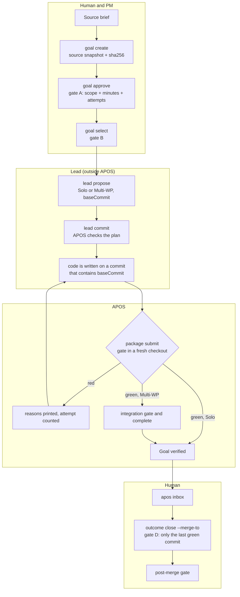

<div align="center">


<br />

**An assurance layer for AI-built software. It runs fixed checks on the commits an agent hands over and records the result. It never takes anyone's word for it, not even an LLM's.**


[**Quick start**](#quick-start) · [**How it works**](#how-it-works) · [**Web UI**](#web-ui) · [**Trust model**](#trust-model) · [**CLI reference**](#cli-reference) · [**Roadmap**](#roadmap)

</div>

<br />

| | |
| --- | --- |
| **Humans own the what** | You approve the Goal, its budget and whether to close it. Never the technical plan. |
| **Whoever orchestrates owns the how** | A Lead (an agent, a script, you) plans and gets the code written, with any tool. APOS does not start, wake or watch an agent. |
| **APOS owns the proof** | Output counts only when a check APOS runs itself, on an exact commit, passes. An LLM saying "done" is a claim, never evidence. |
| **Everything is auditable** | Every event lands in an append-only, hash-chained log you can replay and verify. |

---

## Contents

1. [Purpose](#purpose)
2. [How it works](#how-it-works)
3. [Install](#install)
4. [Quick start](#quick-start)
5. [The Goal contract](#the-goal-contract)
6. [Delivery flows](#delivery-flows)
7. [Project setup](#project-setup) and [Web UI](#web-ui)
8. [Configuration and state](#configuration-and-state)
9. [Trust model](#trust-model)
10. [CLI reference](#cli-reference)
11. [Old logs (legacy Goals)](#old-logs-legacy-goals)
12. [Development](#development)
13. [Limits](#limits)
14. [Roadmap](#roadmap)

---

## Purpose

Plenty of tools run coding agents. Almost none check that the software they ship does the **right thing** and meets a **quality bar**; most let the LLM answer that question itself. APOS v3 is that check, standing outside any orchestrator:

- A Goal is written from a verbatim source, with every requirement mapped to acceptance criteria and to checks a machine can run.
- Work is delivered as commits. `apos package submit` runs the Goal's checks in a fresh detached checkout of that exact commit, compares failures against the base commit, and records `green`, `red`, `needs-human` or `unverifiable`.
- A Goal is verified only on a green gate, and only the commit of the last green gate can be closed.

LLMs may write code, tests and plans. What an LLM says is never the proof.

Design: [`docs/superpowers/specs/2026-11-22-apos-v3-design.md`](docs/superpowers/specs/2026-11-22-apos-v3-design.md) (Vietnamese). Phase-1 plan: [`docs/superpowers/plans/2026-11-22-apos-v3-dot1.md`](docs/superpowers/plans/2026-11-22-apos-v3-dot1.md). Safety cases: [`docs/fault-injection.md`](docs/fault-injection.md).

## How it works

| Who | Decides | Commands |
| --- | --- | --- |
| **PM + Human** | WHAT: which Goals, outcome, acceptance, budget | `goal create --source`, **gate A** `goal approve` |
| **Human** | Which approved Goal is worked next | **gate B** `goal select` |
| **Lead** (agent or person) | HOW: Solo or Multi-WP, packages, base commit. No Human approval | `lead propose`, `package add`, `lead commit` |
| **Whoever writes the code** | Commits on top of the plan's base commit | their own tools; APOS is not involved |
| **APOS** (no LLM) | Machine checks of the plan, the gate on each submitted commit, verification, budget | `package submit`, `integration gate`, `integration complete` |
| **Human** | Whether to close (and merge) | **gate D** `outcome close [--merge-to <branch>]`, `revise`, `stop` |

When the Lead chooses Multi-WP, APOS only **notifies** the Human (`apos inbox`); it does not wait for approval.



### Human-only commands

`goal approve`, `goal appetite`, `goal select`, `outcome close`, `outcome revise`, `outcome stop` and `gate confirm` (plus `gate run --base`, `review submit` and `blocker resolve`) are Human decisions. Each one makes you **type the Goal id back in an interactive terminal**; without a terminal (an agent, a script, a pipe) it is refused and nothing is written. When the Human has said yes elsewhere (say, a click on a task item), pass `--on-behalf "<why>"`: the command runs without asking and the text is recorded. Either way the event carries a `confirmation` entry, so the log shows who decided how.

`goal appetite` is the Human's decision to change the budget, never the scope.

## Install

Requirements: **Node.js 24+** and **Git**. Nothing else: APOS starts no agent.

```bash
npm ci
npm run build
node dist/cli.js --repo /path/to/project init
```

`init` commits `.apos/project.yaml`, copies of the role skills under `.apos/skills/` (`apos-core` as `_core/execute.md`, plus `pm`, `lead`, `worker`, `reviewer`) and entrypoint copies under `.claude/skills/` and `.agents/skills/`. `init` refuses a missing skill or one written for another contract version (`apos-contract: 3`).

**Skills: two copies.** `skills/` in this repo is the stable copy and the default. A copy under development can be tried with `init --skills <dir>` or `APOS_SKILLS`. To bring one over:

```bash
npm run skills:check   -- /path/to/Custom-Skills   # report differences, change nothing
npm run skills:promote -- /path/to/Custom-Skills   # copy into skills/, then run the tests and commit
```

`APOS_DEV_SKILLS` can replace the path argument. `npm run skills:check` alone verifies that the bundled skills are intact.

## Quick start

A Solo Goal from brief to close. `--repo` defaults to the current directory. The Human steps ask you to type the Goal id; add `--on-behalf "<why>"` where no terminal exists.

```bash
# 1. Capture the brief, then draft the Goal from it (see the contract below)
apos goal create --file goal.json --source brief.md

# 2. Gate A: the Human approves the Goal and its budget (minutes from select to verified, red gates per package)
apos goal approve GOAL-001 --size M --max-minutes 240 --max-attempts 3

# 3. Gate B: choose what is worked next
apos goal select GOAL-001

# 4. The Lead proposes a plan, naming the commit the work starts from, and commits it. APOS checks the plan.
apos lead propose --file execution.json     # execution.json carries "baseCommit": "<git rev-parse HEAD>"
apos lead commit GOAL-001

# 5. Get the code written on a commit that contains baseCommit, then submit it. The gate runs inside the command.
apos package submit GOAL-001 WP-MAIN --commit <sha>      # exit 0 green (Goal verified), 1 red, 3 needs a Human / unverifiable
#    red: the failing checks are printed. Fix, commit, submit the new commit.

# 6. Watch from a browser, or wait for the next item that needs you
apos ui                                          # http://127.0.0.1:4343
apos inbox --wait --timeout 5m

# 7. Gate D: close the Goal on the commit that went green, optionally merging that exact commit
apos outcome close GOAL-001 --merge-to main
```

A minimal `execution.json` for a Solo plan:

```json
{
  "id": "EXEC-1", "version": 1, "goalId": "GOAL-001", "goalVersion": 1,
  "mode": "solo-direct",
  "approach": "Implement slugify: lowercase, strip punctuation, split on whitespace, join with dashes",
  "rationale": "Single cohesive module with no independent package seam",
  "baseCommit": "<full sha the work starts from>",
  "risks": [], "sharedPaths": [],
  "estimatedCost": { "wallMinutes": 15 },
  "acceptanceMapping": [{ "acceptanceId": "AC-1", "verification": "node --test" }],
  "verificationStrategy": "Run npm test"
}
```

`baseCommit` is required and must exist in the repo. Every gate compares against it and every submitted commit must contain it.

## The Goal contract

A Goal is a strictly validated JSON document (`src/domain/contracts.ts`). A minimal valid one:

```json
{
  "id": "GOAL-001", "version": 1,
  "outcome": "slugify returns URL-safe slugs",
  "source": {
    "path": "brief.md",
    "sha256": "<sha256 of brief.md>",
    "capturedAt": "2026-11-12T08:00:00Z",
    "origin": "human"
  },
  "requirements": [
    { "id": "R-1", "sourceSpan": "line 3", "text": "slugify lowercases, drops punctuation and joins words with dashes", "disposition": "acceptance" }
  ],
  "scope": ["slugify.js"],
  "exclusions": ["no new dependencies"],
  "acceptance": [
    {
      "id": "AC-1",
      "text": "npm test passes",
      "requirementIds": ["R-1"],
      "examples": [{ "input": "Hello, World!", "expected": "hello-world" }],
      "boundaries": ["empty string returns empty string"],
      "prohibited": ["must not throw on non-ASCII characters"],
      "checkIds": ["CHK-1"]
    }
  ],
  "checks": [
    { "id": "CHK-1", "kind": "command", "command": "npm test", "expect": "pass" }
  ],
  "dependencies": [],
  "priority": 1
}
```

- `requirements[]` lists every requirement lifted from the source, with its span and `disposition: acceptance | excluded`. An excluded requirement must specify `exclusionReason` and `exclusion`: either `{ "kind": "deferred", "to": "GOAL-002" }` (planned for another Goal, which may be a sketch Goal with only `outcome` and `requirements` or not created yet) or `{ "kind": "out-of-scope" }` (dropped with Human approval at Gate A). Run `apos plan [--source brief.md]` to see the multi-Goal plan and each requirement's coverage (`covered`, `planned`, `deferred`, `orphan`, `out-of-scope`).
- `acceptance[]` carries `requirementIds`, `checkIds`, and optionally `examples` (`{ "input": "<text>", "expected": "<text>" }[]` — objects, not strings), `boundaries` (`string[]`), `prohibited` (`string[]`), and `ambiguity` (`{ "status": "resolved", "decision": "<text>" } | { "status": "blocked", "question": "<text>" }`).
- `checks[]` are either `{ kind: "command", command, expect: "pass" | "no-new-failures", failurePattern?, runs, timeoutMs, env }` or `{ kind: "manual", procedure, expectedResult }`. `no-new-failures` needs a `failurePattern` (a regex that recognises a failing line); it runs base and delivery and fails only on failures that are new at delivery.

**Simplest: leave `source` out of `goal.json`.** `goal create` then fills `path`, `sha256`, `capturedAt` and `origin` from `--source`. If you write the `sha256` yourself, APOS hashes the text with CRLF turned into LF, so `Get-FileHash` or `shasum` of a CRLF file on Windows will not match; the error prints the digest APOS expects.

`goal create` snapshots the source with its sha256. **Approval refuses** an unmapped requirement, a `blocked` ambiguity, a missing appetite, and a source snapshot that no longer matches.

The **appetite** (`size`, `maxWallMinutes`, `maxAttempts`, `overrun`) is kept only by APOS. It never appears in Goal documents. There is no spend limit: APOS runs no agent, so it cannot measure spend (`--max-spend` is refused; logs that carry it still replay).

## Delivery flows

### Solo (default)

`lead commit` checks the plan: its source hash and Goal version, that there are no open questions, that `rationale` (or `splitRationale`) explains why Solo or Multi-WP, and that the estimate fits the budget. It then starts execution and gives the Goal one implicit package, **`WP-MAIN`**, that carries every acceptance criterion. Solo and Multi-WP share one path: packages.

`apos package submit <goalId> WP-MAIN --commit <sha> [--by <name>] [--json]`:

1. Refuses (and writes nothing) when the Goal is not executing, the package is unknown or already green, the commit does not exist, or the commit does not contain the plan's `baseCommit`.
2. Runs the gate: a fresh detached checkout of that commit, a tree-killing timeout, base and delivery failures compared. Logs are hashed in the controller home. Only one gate runs per project at a time.
3. Records `package-submitted` and `package-gate-recorded` **after** the gate finishes. A Ctrl-C or a timeout leaves the log untouched and the package submittable again.
4. **Green:** the package is `green`; for Solo the Goal becomes `verified` in the same command. **Red:** the attempt is counted; past `--max-attempts` the Goal is `blocked` and only the Human can go on. **`unverifiable`** (flaky, hung or unrunnable checks, a manual check waiting) leaves the package `needs-human` and no attempt is spent; after the Human acts (`gate confirm`), submit again.

The wall-clock budget runs from `goal select` to `verified`. Past it, `package submit` refuses: with `--overrun ask` the Goal is blocked and the Human decides (raise it with `goal appetite`), with `--overrun stop` the submission is refused and nothing is written. Ending the Goal stays the Human's call (`outcome stop`).

A green gate also prints **warnings** (`needs attention: ...`) when the diff changes tests or oracles, shared paths or the files the checks run. They block nothing and also appear in `apos inbox` and the UI. See [Limits](#limits).

### Multi-WP

Chosen by the Lead when one session is too small. `lead propose` then `package add --file <json> --reason <text>` for each package (at least two, acyclic, versioned interfaces `name@vN`, acceptance with the `checkIds` its gate runs), then `lead commit`. APOS notifies the Human.

- Each package is submitted with `package submit <goalId> <WP-ID> --commit <sha>`. A package with dependencies is submitted only after they are green, on a commit that contains theirs.
- When every package is green: build one integration commit that has every package commit as an ancestor, run `apos integration gate <goalId> --commit <sha> --reason <text>`, and when it is green `apos integration complete <goalId> --commit <sha> [--conflict-resolution <text>]`. That verifies the Goal. A review is not required.
- `package revise` / `add` / `remove` change the plan; a revised package and everything built on it goes back to `pending`.

### Closing

`outcome close` needs the Goal `verified` **and** its verified commit to be the commit of the last green gate (the `WP-MAIN` gate for Solo, the integration gate for Multi-WP). A different commit, a red or missing gate: refused, `--on-behalf` included. `--merge-to <branch>` authorizes one merge of exactly that commit and reruns the gate on the merge; if that gate is red the Goal stays `verified`.

## Project setup

A project can carry a setup (`.apos/project.yaml`, schema version 2): the tools the gate may run, per part of the repo and per layer, with a strict floor. The Lead drafts it from the tool catalogue (`catalog/`: Python, Java with Gradle or Maven, TypeScript), APOS probes every command in clean worktrees, the Human approves it, and each Goal pins the approved version when it is approved. Tools report in one of four standard formats (JUnit XML, SARIF, a metric, APOS JSON) or by exit code alone. See [docs/setup.md](docs/setup.md) and [docs/catalog.md](docs/catalog.md). A repo without a setup still works: guarantees that depend on a setup are off.

## Web UI

`apos ui [--port 4343]` serves a **read-only** web view of one project on `127.0.0.1`. It never writes controller state.

- **Needs you:** gate A and B waiting, blocked Goals, notices (including gate warnings), and verified Goals awaiting an outcome. The list matches `apos inbox`.
- **Goals by who holds them:** Human, Lead, Done. A Goal from an older APOS is labelled **"chỉ đọc – APOS cũ"** (read-only, old APOS).
- **Per Goal:** the story (what the Human gave, what the Lead decided and why), lifecycle, the package graph, gate results with their logs and warnings, findings, reviews, budget use, and the full event timeline.
- There is no login. It binds to loopback, checks the `Host` header, accepts only GET and HEAD, and resolves requests by id rather than path, but anything running as your OS user can read it. A torn final line in a log is ignored; a Goal whose hash chain is broken is flagged while the others still show.

Design: [`docs/design/apos-ui.md`](docs/design/apos-ui.md).

## Configuration and state

Controller state lives **outside the repo**, in `~/.apos/projects/<repo>-<hash>/`:

| Path | Contents |
| --- | --- |
| `events/<GOAL>.jsonl` | Append-only, fsync'd, hash-chained event log. The source of truth. |
| `state.sqlite` | An index, rebuildable from the log. |
| `sources/<GOAL>/v<n>.md` | Verbatim source snapshots. |
| `artifacts/` | Gate logs. |

The repo gets readable Goal documents (`.apos/goals/<id>/`) committed only at milestones: Goal approved, plan accepted, verified, merged, outcome. Events committed into the repo by anyone else are ignored. `apos migrate` imports APOS v1 histories that still fit the contract.

| Environment variable | Effect |
| --- | --- |
| `APOS_HOME` | Move the controller home. |
| `APOS_SKILLS` / `APOS_DEV_SKILLS` | Skills source for `init` / for `skills:check` and `skills:promote`. |
| `APOS_ARTIFACTS` | Move the gate-log folder. |

## Trust model

- **The log is tamper-evident, not a security boundary.** Each event carries the hash of its predecessor, so an edit breaks the chain and is detected; a process running as the same OS user can still read or delete files. APOS assumes a single host operated by a trusted developer.
- **The Human decides through a person, not through a process.** Human commands need the Goal id typed back in a terminal, or an explicit `--on-behalf "<why>"` that is written to the log. A script or agent without a terminal cannot do either by accident. This stops a mistake or a prompt-injected agent, not a process determined to pass `--on-behalf`; the log shows when it did.
- **Lead commands are not authenticated.** `lead *`, `package *` and `integration gate` take `--by <name>` (default `lead`) for the log only. They can only describe a plan and submit commits; the gate, not the caller, decides.
- **An LLM's word is never evidence.** Verification needs a green gate APOS ran on the exact commit. Owner-submitted evidence is a report. A review is advice and gates nothing.
- **The gate protects its own rules.** A delivery that rewrites APOS-managed files (`.apos/`: skills, Goal documents, sources) is red (`APOS-PROTECTED`). Source snapshots are hashed with line endings normalized; a changed or missing snapshot refuses approval and gating.
- **Closing is tied to a gate.** Nothing, `--on-behalf` included, closes a Goal on a commit that is not the last green gate.

## CLI reference

Global option: `--repo <path>` (managed Git project; default: the current directory). Human commands (**H**) also take `--on-behalf <text>`.

| Command | Purpose |
| --- | --- |
| `init [--skills <dir>]` | Initialize `.apos` in a Git project. |
| `migrate` | Import APOS v1 Goal histories into the controller log. |
| `setup draft [--part <name>=<dir>[:<stack>]]... [--force]` | Write a draft `.apos/project.yaml` from the tool catalog (not committed). |
| `setup probe [--commit <rev>]` | Run every tool of the committed setup in clean worktrees and record the result. |
| `setup approve --commit <sha>` | **H.** Approve the probed setup as the next version. |
| `setup show` | Print the latest approved setup version. |
| `goal create --file <json> --source <path> [--origin <text>]` | Draft a Goal bound to a source snapshot. |
| `goal list` | List Goals, their status and the setup version they are pinned to. |
| `plan [--source <path>] [--json]` | Show the multi-Goal plan (including sketch and deferred Goals) and requirement coverage (`covered`, `planned`, `deferred`, `orphan`, `out-of-scope`). |
| `goal approve <id> --size <S\|M\|L> --max-minutes <n> --max-attempts <n> [--overrun <stop\|ask>] [--setup-version <n\|latest>]` | **Gate A (H).** Pins the latest approved setup (or the version given). |
| `goal appetite <id> --reason <text> [appetite flags]` | **H.** Change the budget, not the scope. |
| `goal select <id>` | **Gate B (H).** Records the choice; starts nothing. |
| `goal revise --file <json> --source <path>` | New Goal version; needs re-approval. |
| `lead propose --file <json>` | Submit an execution proposal (`baseCommit` required). |
| `lead commit <id> [--by <name>]` | Accept the plan; execution starts. Solo gets `WP-MAIN`. |
| `package add --file <json> --reason <text>`, `package revise <goalId> --file <json> --reason <text>`, `package remove <goalId> <packageId> --reason <text>`, `package list <goalId>` | Plan the packages of a Multi-WP Goal. |
| `package submit <goalId> <packageId> --commit <sha> [--by <name>] [--json]` | Gate a commit now. Exit 0 green, 1 red, 3 needs-human or unverifiable. |
| `integration gate <goalId> --commit <sha> --reason <text> [--by <name>]` | Gate the integration commit. |
| `integration prepare <goalId>`, `integration complete <goalId> --commit <sha> [--conflict-resolution <text>]`, `integration merge <goalId> --source <commit> --target <branch>` | Multi-WP integration: check, record, merge. |
| `gate run <goalId> --commit <sha> [--base <sha>]` | Run the Goal-level gate on a specific commit (`--base` is **H**). |
| `gate confirm <goalId> <checkId> --commit <sha> --by <name> --note <text>` | **H.** Confirm a manual check. |
| `evidence add <id> --file <json>`, `evidence show <id>` | Owner-reported evidence (a report, not proof). |
| `decision record <id> --note <text>`, `blocker report <id> --kind <kind> --note <text>`, `blocker resolve <id> --note <text>` | Decisions and blockers (`resolve` is **H**). |
| `finding record <id> --kind <intent_gap\|bad_plan\|patch\|defer> --note <text> [--by <name>]` | Record a finding. |
| `review submit <goalId> --file <json>` | **H.** Record a review; it is advice and gates nothing. |
| `outcome close <id> [--merge-to <branch>] [--by <name>]`, `outcome revise <id>`, `outcome stop <id>` | **Gate D (H).** `close` needs the last green gate's commit. |
| `inbox [--wait] [--timeout <dur>] [--since <cursor>] [--json]` | What needs the Human: blocked Goals, verified Goals, gate A/B waiting, notices and gate warnings (`--since` takes the cursor printed last time; `--wait` blocks read-only and exits 2 on timeout). |
| `ui [--port <n>]` | Read-only local web view. |
| `metrics show <goalId>` | Submits per package, red gates and minutes. |

Run `apos <command> --help` for the exact options of any command.

## Old logs (legacy Goals)

Logs written by APOS v2, which started, woke and watched agents itself, still replay and still verify their hash chain. Any Goal that holds one of those events becomes **`legacy`**: it is shown (as read-only in the UI, `legacy` in `goal list`), counts as closed or stopped for plan and dependency purposes when it ended so, and refuses every write, `outcome stop` included. Draft a new Goal to continue the work. `ProjectJournal` also refuses to append an event type v3 does not use. The legacy event names live in `src/domain/legacy-events.ts`; the replay fixtures in `src/store/fixtures/replay/` are real v2 logs. v2 documents are kept in [`docs/archive/`](docs/archive/).

## Development

```bash
npm ci
npm run check         # format, lint, deps, typecheck, test: run before every commit
npm test              # vitest; covers the safety cases in docs/fault-injection.md
npm run build         # tsc -> dist/
npm run skills:check  # bundled skills intact
```

```text
src/
  domain/    contracts (zod), state machine (transitions), gate, packages, plan, legacy-events; imports nothing else
  ports/     interfaces the app depends on (goal repository, commit inspector)
  store/     event log, journal, SQLite index, read-only journal, gate lease
  app/       gate-service, package-service (plan and submit), integration, verification, merge, registry, inbox, metrics
  cli/       context, human-confirm, options and commands/ (one module per group); entry point is src/cli.ts
  ui/        read model, story, HTTP server, single-page UI
  e2e/       whole-Goal flows through the CLI
skills/      stable role skills (apos-core, apos-pm, apos-lead, apos-worker, apos-reviewer)
docs/        architecture/, design/, fault-injection.md, superpowers/ (v3 spec and plans), archive/ (v2)
scripts/     skills promotion
```

Conventions and the dependency rules: [`AGENTS.md`](AGENTS.md), [`docs/architecture/conventions.md`](docs/architecture/conventions.md).

## Limits

- **No test lock yet (until phase 3).** A delivery can change or delete the tests that gate it. The gate flags it as a warning (`needs attention: tests or oracles changed ...`) but does not block it, and a review does not block either. Read the warnings on every green gate.
- **The gate runs the Goal's own checks.** What it proves is only as good as the checks the Goal names. Phase 2 to 5 add the check catalogue, locked acceptance tests and quality layers (see the roadmap).
- **Single host, trusted user** (see the trust model). Windows and Linux; Node 24+.
- **Event log compatibility.** Controller-published document milestones are `documents-published` events with commit and file hashes. Do not roll back to a build older than v3 once a log holds v3 events: such a build does not know them.
- **A Goal is one repo.** A Goal spanning several repos is out of scope for now.
- **Submissions are on the Lead's word.** APOS does not watch a branch for new commits; the Lead runs `package submit`.

## Roadmap

Phase 1 (this version) removed the orchestration layer and put `package submit`, the confirmation on Human commands and the close-on-green-gate rule in place. The next phases, from the v3 design, are **not** in this version:

2. ~~Result formats, a tool catalogue and a project setup with draft, probe and approve~~ (done: see [Project setup](#project-setup)). The gate does not run the setup's layers yet.
3. Locking the acceptance tests before the code is written, red-for-the-right-reason checks, test inventory and scope guards.
4. Test layers L0 to L6 per stage, non-functional proofs and a per-Goal table of what the machine proves and what you confirmed by hand.
5. Reviews and AI tools that can block only with a red test, and mutation testing.
