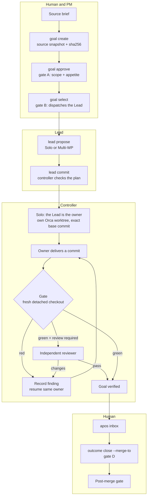

<div align="center">



<br />

**Run AI coding agents on real software Goals, under a controller that never takes anyone's word for it. Not even the agents'.**


[**Quick start**](#quick-start) · [**How it works**](#how-it-works) · [**Web UI**](#web-ui) · [**Trust model**](#trust-model) · [**CLI reference**](#cli-reference)

</div>

<br />

| | |
| --- | --- |
| **Humans own the what** | You approve the Goal, the budget and whether to merge. Never the technical plan. |
| **Agents own the how** | A Lead plans; Owners implement in isolated worktrees, resumed (not restarted) when a check fails. |
| **The controller owns the truth** | No LLM in the loop. It runs the gates itself: an agent saying "done" is a claim, never evidence. |
| **Everything is auditable** | Every event lands in an append-only, hash-chained log you can replay and verify. |

---

## Contents

1. [Why APOS](#why-apos)
2. [How it works](#how-it-works)
3. [Install](#install)
4. [Quick start](#quick-start)
5. [The Goal contract](#the-goal-contract)
6. [Execution flows](#execution-flows)
7. [Web UI](#web-ui)
8. [Telemetry](#telemetry)
9. [Configuration and state](#configuration-and-state)
10. [Trust model](#trust-model)
11. [CLI reference](#cli-reference)
12. [Development](#development)
13. [Status and known limits](#status-and-known-limits)

---

## Why APOS

The design follows what the Hard12 multi-agent runs showed works:

- **One owner keeps the context** of a whole block of work. When a check fails, the controller resumes the *same* owner session instead of starting a cold one.
- **Correctness comes from a source-backed contract and a gate the controller runs itself.** An owner's report that it is done is a claim, never evidence.
- **The Human decides what and what counts as done, not how.** Technical planning belongs to the Lead and needs no Human approval.

Design notes: [`docs/FINAL-DESIGN.md`](docs/FINAL-DESIGN.md) (v2.1, in Vietnamese). Safety cases: [`docs/fault-injection.md`](docs/fault-injection.md).

## How it works

| Who | Decides | Commands |
| --- | --- | --- |
| **PM + Human** | WHAT: which Goals, outcome, acceptance, appetite (budget) | `goal create --source`, **gate A** `goal approve` |
| **Human** | Which approved Goal runs next. Selecting it dispatches its Lead | **gate B** `lead recommend`, `goal select` |
| **Lead** (agent) | HOW: Solo or Multi-WP, packages, interfaces. No Human approval. In Solo it then delivers, in the same session | `lead propose`, `lead commit` |
| **Controller** (no LLM) | Machine checks, dispatch, gates, findings, retries, wake-ups, budget breakers | `controller tick` / `controller watch` |
| **Owner / Worker** (agent) | Implements in its own Orca worktree | dispatched by the controller |
| **Reviewer** (agent) | Independent review in a separate session, when required | dispatched by the controller |
| **Human** | Outcome, and whether to merge | **gate D** `outcome close [--merge-to <branch>]`, `revise`, `stop` |

When the Lead chooses Multi-WP, the controller only **notifies** the Human (`apos inbox`); it does not wait for approval.



### Human-only commands

These refuse to run from any terminal or worktree APOS dispatched an agent into, including the Lead's from the moment it is dispatched, so an agent cannot approve its own work:

- `goal approve`, `goal appetite`, `goal select`, `lead start`, `lead wake`
- `profile set`, `profile reset`, `handoff`
- `outcome close`, `outcome revise`, `outcome stop`
- `gate confirm`, `blocker resolve`, `execution abandon-intent`
- `review submit` (the controller dispatches and reads reviewers itself, so no agent may post a verdict)

`goal appetite` is the Human's overrun decision: it changes only the controller-held budget, never the scope.

## Install

Requirements: **Node.js 24+**, **Git**, and the **Orca CLI** with Codex enabled (the default runtime).

In `~/.codex/config.toml`, set `check_for_update_on_startup = false` (an update prompt blocks Orca workers) and `multi_agent = false` under `[features]` (owners must not spawn sub-agents).

```powershell
npm ci
npm run build
node dist/cli.js --repo C:\path\to\project init
```

`init` commits `.apos/project.yaml`, copies of the role skills under `.apos/skills/` (`apos-core` as `_core/execute.md`, plus `pm`, `lead`, `worker`, `reviewer`) and entrypoint copies under `.claude/skills/`. Briefs pin these copies by sha256, so a later change to the skills reaches a project only when `init` runs again. `init` refuses a missing skill or one written for another contract version (`apos-contract: 2`).

**Skills: two copies.** `skills/` in this repo is the stable copy and the default. The copy under development lives in the Custom-Skills repo; try it with `init --skills <dir>` or `APOS_SKILLS`. To bring it over:

```powershell
npm run skills:check   -- C:\path\to\Custom-Skills   # report differences, change nothing
npm run skills:promote -- C:\path\to\Custom-Skills   # copy into skills/, then run the tests and commit
```

`APOS_DEV_SKILLS` can replace the path argument.

## Quick start

A Solo Goal from brief to merge. `--repo` defaults to the current directory; it is omitted below.

```powershell
# 1. Capture the brief, then draft the Goal from it (see the contract below)
apos goal create --file goal.json --source brief.md

# 2. Gate A: the Human approves the Goal and sets the controller's appetite
apos goal approve GOAL-001 --size M --max-spend 20 --max-minutes 240 --max-attempts 3

# 3. Gate B: choose what runs next; this dispatches the Lead into its own Orca worktree
apos lead recommend
apos goal select GOAL-001

# 4. The Lead (not you) proposes a plan from its own terminal; the controller checks it.
#    Solo: the Lead is the owner and delivers in the same session. Multi-WP: packages are dispatched.
apos --repo C:\path\to\project lead propose --file execution.json
apos --repo C:\path\to\project lead commit GOAL-001

# 5. Supervise (inside an Orca terminal), or run one pass at a time
apos controller watch            # or: apos controller tick

# 6. Watch from a browser, or wait for the next event that needs you (no polling loop needed)
apos ui                                         # http://127.0.0.1:4343
apos inbox --wait --timeout 5m                  # blocks until a gate, decision, notice or verified Goal needs you
apos goal wait GOAL-001 --until verified,blocked --timeout 5m

# 7. Gate D: accept the outcome and merge the gated commit
apos outcome close GOAL-001 --merge-to main
```

A minimal `execution.json` for a Solo plan:

```json
{
  "id": "EXEC-1", "version": 1, "goalId": "GOAL-001", "goalVersion": 1,
  "mode": "solo-direct",
  "approach": "Implement slugify: lowercase, strip punctuation, split on whitespace, join with dashes",
  "rationale": "Single cohesive module with no independent package seam",
  "risks": [], "sharedPaths": [],
  "estimatedCost": { "spendUsd": 1, "wallMinutes": 15 },
  "acceptanceMapping": [{ "acceptanceId": "AC-1", "verification": "node --test" }],
  "verificationStrategy": "Run npm test"
}
```

If a dispatch or resume outcome stays unknown for 10 minutes it appears in `apos inbox`. Check `orca orchestration task-list --run <run_id>` (find `<run_id>` with `orca orchestration run-list`); if Orca created nothing, run `apos execution abandon-intent <id> --key <key> --reason ...`.

## The Goal contract

A Goal is a strictly validated JSON document (`src/domain/contracts.ts`). A minimal valid one:

```json
{
  "id": "GOAL-001", "version": 1,
  "outcome": "slugify returns URL-safe slugs",
  "source": {
    "path": "brief.md",
    "sha256": "<sha256 of brief.md>",
    "capturedAt": "2026-11-12T08:00:00Z",
    "origin": "human"
  },
  "requirements": [
    { "id": "R-1", "sourceSpan": "line 3", "text": "slugify lowercases, drops punctuation and joins words with dashes", "disposition": "acceptance" }
  ],
  "scope": ["slugify.js"],
  "exclusions": ["no new dependencies"],
  "acceptance": [
    {
      "id": "AC-1",
      "text": "npm test passes",
      "requirementIds": ["R-1"],
      "examples": [{ "input": "Hello, World!", "expected": "hello-world" }],
      "boundaries": ["empty string returns empty string"],
      "prohibited": ["must not throw on non-ASCII characters"],
      "checkIds": ["CHK-1"]
    }
  ],
  "checks": [
    { "id": "CHK-1", "kind": "command", "command": "npm test", "expect": "pass" }
  ],
  "dependencies": [],
  "priority": 1
}
```

- `requirements[]` lists every requirement lifted from the source, with its span and `disposition: acceptance | excluded`. An excluded requirement must specify `exclusionReason` and `exclusion`: either `{ "kind": "deferred", "to": "GOAL-002" }` (planned for another Goal, which may be a sketch Goal with only `outcome` and `requirements` or not created yet) or `{ "kind": "out-of-scope" }` (dropped with Human approval at Gate A). Run `apos plan [--source brief.md]` to see the multi-Goal plan and each requirement's coverage (`covered`, `planned`, `deferred`, `orphan`, `out-of-scope`).
- `acceptance[]` carries `requirementIds`, `checkIds`, and optionally `examples` (`{ "input": "<text>", "expected": "<text>" }[]` — objects, not strings), `boundaries` (`string[]`), `prohibited` (`string[]`), and `ambiguity` (`{ "status": "resolved", "decision": "<text>" } | { "status": "blocked", "question": "<text>" }`).
- `checks[]` are either `{ kind: "command", command, expect: "pass" | "no-new-failures", failurePattern?, runs, timeoutMs, env }` or `{ kind: "manual", procedure, expectedResult }`. `no-new-failures` needs a `failurePattern` (a regex that recognises a failing line); it runs base and delivery and fails only on failures that are new at delivery.

**Simplest: leave `source` out of `goal.json`.** `goal create` then fills `path`, `sha256`, `capturedAt` and `origin` from `--source`. If you write the `sha256` yourself, APOS hashes the text with CRLF turned into LF, so `Get-FileHash` or `shasum` of a CRLF file on Windows will not match; the error prints the digest APOS expects.

`goal create` snapshots the source with its sha256. **Approval refuses** an unmapped requirement, a `blocked` ambiguity, a missing appetite, and a source snapshot that no longer matches.

The **appetite** (`size`, `maxSpendUsd`, `maxWallMinutes`, `maxAttempts`, `overrunPolicy`) is kept only by the controller. It never appears in Goal documents or briefs.

## Execution flows

### Solo (default)

**Before dispatch** (`lead commit`), the controller checks the plan's source hash and Goal version, that there are no open questions, that `rationale` (or `splitRationale`) explains why the Lead chose Solo or Multi-WP, and that the estimate fits the appetite. For Multi-WP it also checks at least two packages, an acyclic graph, versioned interfaces (`name@vN`), acceptance coverage and a split rationale.

**The Lead is dispatched at gate B.** `goal select` starts the Lead in its own Orca worktree, cut from the managed repo's HEAD at that moment (its base commit). The appetite's wall clock starts here: planning counts. `lead propose` and `lead commit` are accepted only from that Lead's terminal, and the plan gates against the Lead's base, even if `main` moves meanwhile. If Orca refused the dispatch, `apos lead start <id>` retries it; an unknown outcome is recovered by key and reaches `apos inbox` after 10 minutes.

**Solo has no second dispatch.** When `lead commit` accepts a Solo plan, the controller records the Lead's own dispatch as the owner, and the Lead keeps going in the same turn with everything it read while planning. If the Lead ends its turn before any plan is accepted (for example the estimate exceeds the appetite), `apos inbox` says so; decide, then `apos lead wake <id> --note "..."` resumes it in the same terminal.

**Dispatch.** Every agent runs in its own Orca worktree created from an exact base commit, using its role profile (default: Codex `gpt-6.1-terra` for Lead and Worker, `gpt-6-sol` for Reviewer). The brief points at `.apos/skills/_core/execute.md` and the role skill by path and sha256, and names the activation line the delivery report must contain.

**Agents per role.** Each role (Lead, Worker, Reviewer) can run `codex`, `claude` or `antigravity` (Orca's agent ids; another id Orca knows also launches). `apos profile set <lead|worker|reviewer|all> --agent <id> [--model <id> [--effort <level>]]` changes it, `apos profile show` lists it, `apos profile reset [role]` goes back to the default. Changing the agent drops the old model. The next dispatch of that role uses the new profile, and so do resumes and wakes: when the running agent differs from the role's profile, APOS starts the new agent in a fresh terminal on the same worktree with the full role brief instead of resuming the old terminal. PM is your own session, not dispatched: `apos init` installs the role skills in `.claude/skills/` (Claude Code) and `.agents/skills/` (Codex, Antigravity).

**Out of quota.** Orca itself reports an agent that hit its limit as an escalation on the Run (`Agent hit an error: Codex hit its usage limit.`); the controller turns it into one `agent-exhausted` notice in `apos inbox` naming the role, the agent and the agent's own line, and does not answer the stuck agent. As a second signal, when a running dispatch has been quiet for 2 minutes, the controller reads its screen with that agent's rules. If the agent's own out-of-quota line is there (Claude: `You've hit your weekly limit · resets …`; Codex: `You’ve hit your usage limit …`), `apos inbox` gets one `agent-exhausted` notice naming the role, the agent and the line. Otherwise a dispatch quiet for 15 minutes gets one `owner-idle` notice. This is code reading the terminal; it spends no tokens. Antigravity's quota line has not been seen yet, so it is reported only as `owner-idle`.

**Handoff.** `apos handoff <goalId> [--package <id> | --reviewer] [--agent <id> [--model] [--effort]]` moves that owner (default: the Lead, planning, Solo owner or Multi-WP) to a fresh agent on the same worktree: it stops the old dispatch (`orca orchestration worker-stop`), refuses to go on if Orca cannot confirm it stopped, and starts the role's profile with the full role brief plus how to pick up the previous agent's work. Commits and uncommitted changes stay in the worktree. It spends no attempt, and while it runs the controller does not count the stopped dispatch as failed. `--agent` also makes that agent the role's profile. A Goal or package blocked only because that very dispatch settled `failed` is unblocked; any other block is refused.

**After the owner settles**, `controller tick`:

1. Compares the launch receipt with the requested model. A mismatch is `needs-decision`.
2. Reads the delivery head of the owner's worktree and checks that the committed report carries the activation line. If not, a finding resumes the same owner.
3. Runs the **gate**: a fresh detached worktree at that exact commit, with a tree-killing timeout, comparing base and delivery failures. Logs are hashed in the controller home.
4. **Green.** If review is required (Multi-WP, declared risks, changed tests or oracles, changed shared paths), a reviewer runs in a separate session. Otherwise the Goal is `verified` and waits for the Human.
5. **Red.** The controller records a finding (check IDs, commit, logs) and resumes the same owner in the same terminal and worktree.
6. **Stops at `needs-decision`** when the cause is unknown or the gate is unverifiable, the same failure survives two repairs, the attempt budget or wall time is spent, or the owner reports `failed`.

`outcome close --merge-to <branch>` records a one-time authorization for the gated commit and merges it, then reruns the gate on the merge commit. If that gate is red the Goal stays open.

**Manual checks** stay pending until someone other than the owner confirms them: `gate confirm GOAL-001 <checkId> --commit <sha> --by <name> --note "..."`.

**Findings** (`finding record --kind`): `intent_gap` parks the Goal for PM and the Human; `bad_plan` is for the Lead to revise; `patch` goes to the owner; `defer` goes to the backlog.

### Multi-WP

The Lead adds packages (`package add --file wp.json`). Each names its owner, dependencies, versioned interfaces and local acceptance, optionally with `checkIds` from the Goal's checks. Then the Lead runs `lead commit GOAL-001` from its own terminal. APOS already knows that terminal from the Lead's dispatch and wakes it there (`--terminal` is no longer needed; if given, it must match). The Lead reports `worker_done` and ends its turn once the packages are dispatched.

The controller then:

- dispatches packages as their dependencies are verified;
- gates each settled package on its own head against its base: green verifies the package, red sends it back to the same owner with the finding;
- wakes the Lead's terminal once per batch of new events (package results, owner questions, ready to integrate, a red integration gate), and only after the Lead's previous turn has settled.

The Lead integrates each package commit as an ancestor. A sequential chain may use its last package head directly. After a passing Goal review, run `apos integration complete <goalId> --commit <sha>`; add `--conflict-resolution <text>` when packages changed the same files.

Order: the Lead integrates and commits; the controller gates that commit and dispatches the Goal reviewer; on a pass the controller wakes the Lead, who runs `integration complete` (a call before the review passes is refused and names what is missing).

`integration complete` gates the integration commit itself. Every Multi-WP Goal needs an independent Goal review before it can verify; once the integration gate is green on a commit that contains every package, the controller dispatches that reviewer itself (one per gated commit) and wakes the Lead with the verdict. A Multi-WP plan must not declare `risks`: they would demand package reviews APOS does not dispatch.

## Web UI

`apos ui [--port 4343]` serves a **read-only** web view of one project on `127.0.0.1`. It observes; it never runs the controller (start `controller watch` separately) and never writes controller state.

- **Needs you:** gate A and B waiting, `needs-decision`, notices, and verified Goals awaiting an outcome. The list matches `apos inbox`.
- **Goals by who holds them:** Human, Lead, Controller / agent, Done.
- **Story tab** (default per Goal): what the Human gave; what the Lead decided (mode, approach, why it split or did not, risks, verification, estimated cost against the appetite); and for each owner the latest checkpoint, observed worktree progress (commits since base and uncommitted changes), decisions, checkpoints, evidence, blockers, findings and reviews it put on record.
- **Agent activity:** for each dispatch, the agent's own transcript (Codex rollouts under `~/.codex/sessions`, Claude Code sessions under `~/.claude/projects`, Antigravity transcripts under `~/.gemini/antigravity-cli`; `CODEX_HOME`, `CLAUDE_CONFIG_DIR` and `ANTIGRAVITY_HOME` move them), newest first, refreshing every 3 seconds while the owner runs: what it said, planned, ran and got back.
- **Also:** lifecycle, Work Package graph, gate results with their logs, telemetry and appetite use, and the full event timeline.

What to know before relying on it:

- **No reasoning is shown.** Both agents encrypt or blank their reasoning, so only what they wrote and did is visible. This is the agent's own account, not a verified one.
- **Transcripts are matched to a dispatch by worktree path and time.** Where the transcript head carries the dispatch id (Antigravity), that id also matches; Codex and Claude Code have no such id, so a reused worktree is told apart only by the time window. The page says so.
- **Secrets are hidden by pattern** (keys, tokens, `NAME_KEY=value`). That is best effort, not a guarantee, and a transcript can contain anything the agent saw.
- **There is no login.** It binds to loopback, checks the `Host` header, accepts only GET and HEAD, and resolves every request by id rather than path, but anything running as your OS user can read it. Keep it on a machine only you use.
- It reads event logs without locking, creating or rebuilding anything. A torn final line is ignored, and a Goal whose hash chain is broken is flagged while the others still show.
- Spend in USD is not shown: APOS has no price table. Tokens, attempts and wall time are.

Design: [`docs/design/apos-ui.md`](docs/design/apos-ui.md), [`docs/design/apos-ui-activity.md`](docs/design/apos-ui-activity.md).

## Telemetry

`telemetry-recorded` events hold, per dispatch and role: the requested and launched model, token usage (input, cached, output) read from the owner's Codex session files, and wall time. Claude and Antigravity owners are not measured yet. When nothing matches, the usage is recorded as `unknown`, never estimated. `apos metrics show <goalId>` summarizes a Goal.

## Configuration and state

Controller state lives **outside the repo**, in `~/.apos/projects/<repo>-<hash>/`:

| Path | Contents |
| --- | --- |
| `events/<GOAL>.jsonl` | Append-only, fsync'd, hash-chained event log. The source of truth. |
| `state.sqlite` | An index, rebuildable from the log. |
| `sources/<GOAL>/v<n>.md` | Verbatim source snapshots. |
| `artifacts/` | Gate logs. |
| `runtime.json` | Optional role profiles in the controller home (`~/.apos/projects/<repo-name>-<hash>/`), written by `apos profile set` and `apos handoff --agent`: `{ "lead": { "agent": "claude" }, "worker": { "agent": "codex", "model": "gpt-6-luna" }, "reviewer": { ... } }`. `model` and `effort` are optional; use the model id the agent accepts. |

The repo gets readable Goal documents (`.apos/goals/<id>/`) committed only at milestones: Goal approved, plan accepted, verified, merged, outcome. Events committed into the repo by anyone else are ignored. `apos migrate` imports APOS v1 histories that still fit the contract.

| Environment variable | Effect |
| --- | --- |
| `APOS_HOME` | Move the controller home. |
| `APOS_SKILLS` / `APOS_DEV_SKILLS` | Skills source for `init` / for `skills:check` and `skills:promote`. |
| `APOS_ARTIFACTS` | Move the gate-log folder. |
| `CODEX_HOME`, `CLAUDE_CONFIG_DIR`, `ANTIGRAVITY_HOME` | Where agent transcripts are read from (UI and telemetry). |

## Trust model

The controller home is **tamper-evident**, not a security boundary against a process that runs as the same OS user. Each event carries the hash of its predecessor, so an edit to the log breaks the chain and is detected; it does not stop an agent with the same user rights from reading or deleting files. The Human-only commands rely on APOS recognizing the terminals and worktrees it dispatched, which guards against an agent acting by mistake or by prompt, not against a determined local process. APOS assumes a single host operated by a trusted developer.

## CLI reference

Global option: `--repo <path>` (managed Git project; default: the current directory).

| Command | Purpose |
| --- | --- |
| `init [--skills <dir>]` | Initialize `.apos` in a Git project. |
| `migrate` | Import APOS v1 Goal histories into the controller log. |
| `goal create --file <json> --source <path> [--origin <text>]` | Draft a Goal bound to a source snapshot. |
| `goal list` | List Goals and their status. |
| `plan [--source <path>] [--json]` | Show the multi-Goal plan (including sketch and deferred Goals) and requirement coverage (`covered`, `planned`, `deferred`, `orphan`, `out-of-scope`). |
| `goal approve <id> --size <S\|M\|L> --max-spend <usd> --max-minutes <n> --max-attempts <n> [--overrun <stop\|ask>]` | **Gate A (Human).** |
| `goal appetite <id> --reason <text> [appetite flags]` | **Human.** Change the controller budget, not the scope. |
| `goal select <id>` | **Gate B (Human).** Also dispatches the Goal's Lead. |
| `goal revise --file <json> --source <path>` | New Goal version; needs re-approval. |
| `goal wait <id> --until <state[,state...]> [--timeout <dur>]` | Block read-only until `<id>` reaches one of the target statuses or emits a new notice (exit code 2 on timeout). |
| `lead recommend` | Recommend the next eligible Goal. |
| `lead start <id>` | **Human.** Dispatch the Lead of a selected Goal (retry after a refused dispatch, or for a Goal selected before this version). |
| `lead wake <id> --note <text>` | **Human.** Resume a Lead that ended its turn before its plan was accepted, in its own terminal, with your decision. |
| `profile show`, `profile set <role|all> --agent <id> [--model <id>] [--effort <level>]`, `profile reset [role|all]` | Which agent each role runs; `set` and `reset` are **Human**. |
| `handoff <goalId> [--package <id> | --reviewer] [--agent <id> [--model] [--effort]]` | **Human.** Move a stuck owner (for example out of quota) to a fresh agent on the same worktree; no attempt spent. |
| `lead propose --file <json>` | Submit an execution proposal. |
| `lead commit <id>` | Lead only, from its own terminal. Controller checks the plan; Solo: the Lead becomes the owner; Multi-WP: dispatches packages. |
| `package add --file <json>`, `package revise <goalId> --file <json> --reason <text>` | Multi-WP packages. |
| `integration prepare <goalId>`, `integration complete <goalId> --commit <sha>`, `integration merge <goalId> --source <commit> --target <branch>` | Multi-WP integration: prepare, record the integration commit, merge. |
| `controller tick` | One controller pass: reconcile, gate, dispatch, wake. |
| `controller watch [--interval-ms <n>]` | Continuous loop, inside an Orca terminal (1000 to 300000 ms; default 15000). |
| `gate run <goalId> --commit <sha> [--base <sha>]` | Run the gate on a specific commit. |
| `gate confirm <goalId> <checkId> --commit <sha> --by <name> --note <text>` | **Human.** Confirm a manual check. |
| `execution checkpoint <id> --file <json>`, `execution retry <id> --reason <text>`, `execution abandon-intent <id> --key <key> --reason <text>` | Owner checkpoint, retry, and (Human) drop an unknown intent. |
| `evidence add <id> --file <json>`, `evidence show <id>` | Owner evidence. |
| `decision record <id> --note <text>`, `blocker report <id> --kind <kind> --note <text>`, `blocker resolve <id> --note <text>` | Decisions and blockers (`resolve` is Human). |
| `finding record <id> --kind <intent_gap\|bad_plan\|patch\|defer> --note <text> [--by <name>]` | Record a finding. |
| `outcome close <id> [--merge-to <branch>] [--by <name>]`, `outcome revise <id>`, `outcome stop <id>` | **Gate D (Human).** |
| `execution start\|resume\|status\|reconcile\|verify <id>`, `review submit <goalId>` | Lower-level controls the controller normally drives itself; see `--help`. `review submit` is Human-only. |
| `inbox [--wait] [--timeout <dur>] [--since <cursor>] [--json]` | What needs the Human: notices, blocked Goals, verified Goals awaiting an outcome, and Gate A/B waiting (plain, `--since`, `--json` and `--wait` all list the same items; `--since` takes the cursor printed last time, which only holds the items waiting then; `--wait` blocks read-only on the event log and exits 2 on timeout). |
| `ui [--port <n>]` | Read-only local web view. |
| `metrics show <goalId>` | Tokens, attempts and wall time. |

Run `apos <command> --help` for the exact options of any command.

## Development

```powershell
npm ci
npm test              # vitest; covers every safety case in docs/fault-injection.md
npm run typecheck     # tsc --noEmit
npm run build         # tsc -> dist/
```

```text
src/
  domain/    contracts (zod), state machine (transitions), gate, packages, runtime-refs; imports nothing else
  ports/     interfaces the app depends on (runtime, goal repository, commit inspector, telemetry)
  store/     event log, journal, SQLite index, read-only journal
  runtime/   agent adapters, brief builder, screen rules, telemetry probe
    orca/    Orca adapter split into exec, parse, git, handoff, packages and adapter
  app/       controller, gate-service, package-service, review, merge, supervisors, inbox, events
  cli/       context, options and commands/ (one module per command group); entry point is src/cli.ts
    commands/
  ui/        read model, story, agent activity, HTTP server, single-page UI
skills/      stable role skills (apos-core, apos-pm, apos-lead, apos-worker, apos-reviewer)
docs/        FINAL-DESIGN.md, fault-injection.md, design/
scripts/     skills promotion
```

## Status and known limits

APOS has run live on real Orca with Codex (`gpt-6.1-terra`): a clean Solo Goal, a repair path (the gate went red, the same terminal was resumed, the Goal verified and merged), and a Solo Goal through independent review, repair, a second review, `verified`, closed and merged under `controller watch` with no manual step. These runs found and fixed multi-line briefs stalling in the Codex composer, an owner committing into the managed checkout, Orca timing out on a dispatch that had started, a resume refused right after `worker_done`, and telemetry double counting.

Known limits:

- **Event log compatibility.** Controller-published document milestones are recorded as `documents-published` events with commit and file hashes. Do not roll back to an older version after this event appears in a log; older logs without milestones keep the protected-file guard strict.
- **Spend is not enforced.** `maxSpendUsd` and `overrunPolicy` are recorded, but there is no price table and an overrun only notifies. The controller never stops a running owner on its own; it only declines to resume it. Only the Human's `apos handoff` stops one.
- **Multi-WP has run live on a dependent-package trial** (commit `9c7385d`). A dependent chain has not been rerun after subsequent fixes, and a Multi-WP review requesting changes has not been verified live.
- **The quality pilot did not beat the baseline.** On the SQLFMT task APOS ended with 28/32 target tests against the single-agent baseline's 32/32, and the controller blocked the Goal rather than verify it. The current aim is a smooth controller, not accuracy.
- **Upgrading from a version before `rationale`.** A proposal saved without `rationale` (or `splitRationale`) is refused by `lead commit`. Add a `rationale` string to the execution JSON, re-run `apos lead propose --file <execution.json>` from the Lead terminal, then `apos lead commit <id>`.
- **Upgrading from a version before the Lead dispatch.** A Goal selected, planned or accepted under the old flow has no APOS Lead: `lead commit` refuses it and `apos inbox` asks you to run `apos lead start <id>`; the new Lead proposes and commits again. Goals already executing are unaffected. Do not roll back below this version once a log holds `lead-*` events: older builds cannot replay event types they do not know (this build ignores unknown ones).
- **The Lead runs `apos` with `--repo`.** It works in its own worktree, so its commands must name the managed repo; its brief says so.
- **Claude and Antigravity owners have not yet run a full Goal live.** Their screen rules come from real captures (`src/runtime/fixtures/screens/`); Orca opens Claude as a chat, so there is no composer to rescue. Antigravity's out-of-quota line is unknown.
- **Agent activity in the UI is verified against Codex dispatches.** The Claude Code reader works on real Claude Code transcripts but has not yet seen a Worker dispatched by APOS. The Antigravity reader (root `ANTIGRAVITY_HOME`, default `~/.gemini/antigravity-cli`; `history.jsonl` and `brain/<id>/.system_generated/logs/transcript.jsonl`) is tested only against synthetic fixtures, not verified against a real Antigravity run.
- **Single host, trusted user** (see the trust model).
