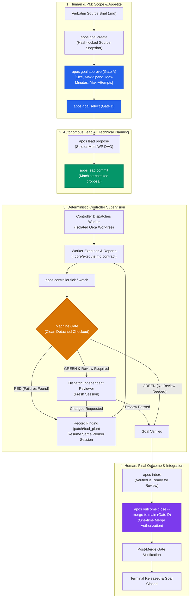
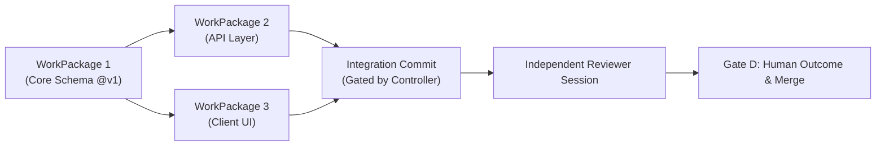

# APOS v2 — AI Project Orchestration System

<p align="center">
  <strong>Autonomous AI agent orchestration and governance platform for software engineering goals.</strong><br>
  Built on empirical multi-agent research: single-owner context retention, deterministic machine-verified gates, and strict human governance.
</p>

<p align="center">
  
  
  
  
  
  
</p>

---

## Table of Contents

- [Overview & Core Philosophy](#overview--core-philosophy)
- [Governance & Responsibility Matrix](#governance--responsibility-matrix)
- [Architecture & Lifecycle](#architecture--lifecycle)
- [Installation & Setup](#installation--setup)
- [Execution Workflows](#execution-workflows)
  - [1. Solo Flow (Default)](#1-solo-flow-default)
  - [2. Multi-WorkPackage (Multi-WP) Flow](#2-multi-workpackage-multi-wp-flow)
- [The Goal Contract](#the-goal-contract)
- [Local Web UI (`apos ui`)](#local-web-ui-apos-ui)
- [Anti-Tamper & Security Model](#anti-tamper--security-model)
- [CLI Reference](#cli-reference)
- [Validation & Fault Injection](#validation--fault-injection)
- [Operational Notes & Roadmap](#operational-notes--roadmap)

---

## Overview & Core Philosophy

APOS (AI Project Orchestration System) coordinates autonomous coding agents (Codex, Claude Code via Orca) to deliver software goals safely. Rather than relying on agent self-reports or loose conversational prompts, APOS enforces software engineering rigor through lessons learned from the Hard12 multi-agent benchmark:

1. **One Owner Keeps the Context:** Every task block belongs to a single primary owner operating inside a dedicated, isolated worktree. If a machine check fails, APOS resumes the **exact same owner session**, preserving full cognitive context rather than spinning up cold, amnesic agents.
2. **Correctness via Deterministic Machine Gates:** An AI agent's self-declaration of completion is treated as a claim, never as evidence. The APOS Controller (a zero-LLM, deterministic state engine) checks out clean code in fresh temporary worktrees and runs automated verification gates independently.
3. **Strict Separation of Concerns:**
   - **Human + PM:** Decides **WHAT** to build, acceptance criteria, exclusions, and resource appetite (Budget, Wall Time, Attempts).
   - **Lead AI:** Autonomously plans **HOW** to implement (Solo vs. Multi-WP, architecture, interface schemas). No human bottleneck on technical planning.
   - **Controller:** Mechanically supervises dispatch, executes gates, logs structured findings, auto-resumes repairs, and halts on budget breaches.

> [!NOTE]
> For the comprehensive mathematical and behavioral specification, see [FINAL-DESIGN.md](docs/FINAL-DESIGN.md) (v2.1, in Vietnamese) and [fault-injection.md](docs/fault-injection.md).

---

## Governance & Responsibility Matrix

APOS enforces explicit decision boundaries. Human-only commands **strictly refuse to run** from any terminal or worktree dispatched by APOS, preventing autonomous agents from approving their own work or granting themselves merge rights.

| Role | Authority Scope | Responsibilities | Key Commands |
| :--- | :--- | :--- | :--- |
| **Human & PM** | **WHAT** | Selects target goals, locks verbatim source requirements, sets acceptance criteria & appetite limits. | `apos goal create`<br>`apos goal approve` (**Gate A**)<br>`apos goal select` (**Gate B**) |
| **Lead AI** | **HOW** | Decides execution mode (Solo vs Multi-WP), designs packages, dependencies & versioned interfaces. Commits directly without human gating. | `apos lead recommend`<br>`apos lead propose`<br>`apos lead commit` |
| **Controller** | **SUPERVISION** | Non-LLM mechanical engine. Dispatches Orca workers, verifies delivery hashes, runs isolated gates, logs findings, manages timeouts. | `apos controller tick`<br>`apos controller watch` |
| **Owner / Worker** | **EXECUTION** | Implements code in dedicated worktrees following the `_core/execute.md` skill discipline. | Handled via Orca sessions |
| **Reviewer** | **INSPECTION** | Independent AI session dispatched by the controller for risky, multi-package, or test-modifying deliveries. | Dispatched automatically |
| **Human** | **OUTCOME & MERGE** | Inspects verification reports, decides outcome, grants one-time merge authorization to the protected branch. | `apos outcome close` (**Gate D**)<br>`apos outcome revise`<br>`apos outcome stop` |

### Human-Only Guardrails (`assertHuman`)
The following commands immediately abort if executed from within an agent terminal (`$ORCA_TERMINAL_HANDLE`) or an APOS worker worktree:
- **Governance:** `goal approve`, `goal appetite`, `goal select`
- **Closure:** `outcome close`, `outcome revise`, `outcome stop`
- **Overrides:** `gate confirm` (manual check verification), `blocker resolve`, `execution abandon-intent`
- **Reviews:** `review submit` (review verdicts are strictly controller-managed)

---

## Architecture & Lifecycle

The following diagram illustrates how a Goal moves from initial drafting to human-authorized merge:



---

## Installation & Setup

### Prerequisites
- **Node.js**: `v24.0.0` or higher
- **Git**: `2.40+`
- **Orca CLI** with Codex/Claude enabled (standard runtime execution engine)

### Environment Configuration
Ensure your `~/.codex/config.toml` includes:
```toml
check_for_update_on_startup = false   # Prevents interactive update prompts from blocking workers
[features]
multi_agent = false                   # Workers must not autonomously spawn rogue sub-agents
```

### Build & Initialize
```bash
# Clone and install dependencies
git clone https://github.com/your-org/apos.git
cd APOS
npm ci
npm run build

# Link CLI globally (optional) or run via dist/cli.js
npm link
```

### Initializing a Project
Initialize APOS within your target repository:
```powershell
# Using stable skills bundled with APOS
apos --repo C:\path\to\your\project init

# Using skills from a custom development directory
apos --repo C:\path\to\your\project init --skills C:\path\to\Custom-Skills
```

`apos init` sets up:
- `.apos/project.yaml`: Repository tracking configuration.
- `.apos/skills/`: Pinned copies of `_core/execute.md`, `apos-pm`, `apos-lead`, `apos-worker`, and `apos-reviewer`.
- `.claude/skills/`: Mirrored entrypoint skills.
- Pinning validation: Briefs pin committed skills by SHA256 to prevent silent prompt drift.

### Synchronizing Skills
APOS maintains a strict contract version (`apos-contract: 2`) between runtime code and agent skills:
```powershell
# Check for differences without touching local files
npm run skills:check -- C:\path\to\Custom-Skills

# Promote and copy development skills into the stable skills/ directory
npm run skills:promote -- C:\path\to\Custom-Skills
```

---

## Execution Workflows

### 1. Solo Flow (Default)
Recommended for all standard goals with a unified scope. A single worker takes end-to-end responsibility.

```powershell
# 1. Draft the Goal from a verbatim requirements document
apos goal create --file goal.json --source brief.md

# 2. Gate A: Human approves scope and establishes controller appetite
apos goal approve GOAL-001 --size M --max-spend 20 --max-minutes 240 --max-attempts 3

# 3. Gate B: Human selects the Goal for active development
apos lead recommend
apos goal select GOAL-001

# 4. Lead AI prepares execution proposal and commits (No Human plan gate required)
apos lead propose --file execution.json
apos lead commit GOAL-001

# 5. Start the mechanical controller supervisor
apos controller watch

# 6. Check status and alerts
apos inbox

# 7. Gate D: Inspect verification and authorize merge
apos outcome close GOAL-001 --merge-to main
```

#### What the Controller Checks Upon Settlement:
1. **Model Receipt Verification:** Ensures the launched model matches the planned profile (e.g. `gpt-6.1-terra`). Mismatches flag `needs-decision`.
2. **Delivery Contract Integrity:** Checks that the delivery commit contains the mandatory activation phrase from `_core/execute.md`.
3. **Clean Worktree Gate Execution:** Spawns a clean detached worktree at the delivery commit, runs regression checks against base commit failures, and hashes execution logs.
4. **Automated Repair Loop:** On a red gate, logs an exact finding (`patch`) with failure logs and re-wakes the *same* worker session in its existing worktree.
5. **Circuit Breakers:** Escalates to `needs-decision` in `apos inbox` if identical failures persist through 2 repair cycles or limits expire.

---

### 2. Multi-WorkPackage (Multi-WP) Flow
Designed for large-scale features with independent modules, clear interface boundaries, and minimal code overlap.



1. **Package Graph:** The Lead decomposes the Goal into work packages using `apos package add --file wp.json`. Each package specifies versioned interfaces (`name@vN`), local acceptance criteria, and explicit dependencies.
2. **Autonomous Dispatch:** The controller automatically dispatches workers for packages whose dependencies have verified.
3. **Lead Orchestration:** As packages finish, the controller wakes the Lead AI's terminal with aggregated event batches to handle integration.
4. **Mandatory Review:** Multi-WP integrations require a fresh, independent reviewer AI session before the Goal can enter `verified` status.

---

## The Goal Contract

Every Goal is backed by a strictly typed contract (`src/domain/contracts.ts`):

```jsonc
{
  "id": "GOAL-001",
  "version": 1,
  "problem": "Brief description of the problem statement",
  "outcome": "Measurable end-state definition",
  "source": {
    "path": "docs/briefs/feature-brief.md",
    "sha256": "e3b0c44298fc1c149afbf4c8996fb92427ae41e4649b934ca495991b7852b855",
    "capturedAt": "2026-11-12T10:00:00.000Z",
    "origin": "human"
  },
  "requirements": [
    {
      "id": "REQ-1",
      "sourceSpan": "Lines 12-18",
      "text": "CLI must support --json output flag",
      "disposition": "acceptance",
      "acceptanceIds": ["ACC-1"]
    }
  ],
  "acceptance": [
    {
      "id": "ACC-1",
      "requirementIds": ["REQ-1"],
      "expected": "Valid JSON output emitted to stdout when --json is provided",
      "examples": [{ "input": "apos goal list --json", "expected": "[{...}]" }],
      "boundaries": ["Empty list returns '[]' with exit code 0"],
      "prohibited": ["Do not write debug logs to stdout when --json is active"],
      "checkIds": ["CHK-CLI-JSON"],
      "ambiguity": { "status": "resolved", "decision": "Strict JSON array" }
    }
  ],
  "checks": [
    {
      "id": "CHK-CLI-JSON",
      "kind": "command",
      "command": "npm test -- tests/cli-json.test.ts",
      "expect": "pass",
      "timeoutMs": 30000
    }
  ]
}
```

> [!IMPORTANT]
> **Source Immutability:** `goal approve` fails if any requirement from the source is unmapped, if an unresolved ambiguity exists, or if the source file SHA256 has drifted from the snapshot.

---

## Local Web UI (`apos ui`)

APOS provides a zero-dependency, read-only web dashboard running on `127.0.0.1:4343`:

```powershell
apos ui --port 4343
# Access: http://127.0.0.1:4343
```

```
┌────────────────────────────────────────────────────────────────────────┐
│ APOS Dashboard                                        [Port: 4343]     │
├───────────────┬─────────────────────────────┬──────────────────────────┤
│ Needs Human   │ In Progress                 │ Completed                │
│ • GOAL-002: A │ • GOAL-001 (Solo: Worker)   │ • GOAL-SMOKE-V2 (Merged) │
│ • GOAL-003: D │ • WP-02 (Multi: In-Review)  │                          │
└───────────────┴─────────────────────────────┴──────────────────────────┘
```

### Dashboard Features:
- **Zero-Mutation Safety:** Reads directly from event logs without taking locks or touching repository state. Broken hash chains are safely flagged per Goal without crashing the interface.
- **Goal Story View:** Chronologically details what the Human specified, the Lead's architectural strategy, risks, and evidence submitted by each worker.
- **Live Agent Transcript Inspector:** Inspects ongoing Codex (`~/.codex/sessions`) and Claude Code (`~/.claude/projects`) worker activity. Streams commands, file edits, and outputs in real time while censoring private keys, tokens, and stripping encrypted raw thinking.

---

## Anti-Tamper & Security Model

APOS enforces strict physical and logical boundaries between target code and orchestration control:

```
HOST ENVIRONMENT
├── ~/.apos/projects/<repo>-<hash>/       ◄── [CONTROLLER HOME: OUTSIDE REPO]
│   ├── events/<GOAL>.jsonl               # Hash-chained, append-only immutable event log
│   ├── state.sqlite                      # Rebuildable fast-lookup query index
│   ├── sources/<GOAL>/v<n>.md            # Immutable verbatim source snapshots
│   ├── artifacts/                        # Full raw gate execution logs
│   └── runtime.json                      # Custom model profiles (e.g. gpt-6.1-terra)
│
└── C:\path\to\your\repo\                 ◄── [TARGET REPOSITORY]
    ├── .apos/
    │   ├── project.yaml                  # Project identity & metadata
    │   └── skills/                       # Committed & SHA-pinned role skills
    └── src/...                           # Working code under development
```

- **Hash-Chained Journal:** Every event in `events/<GOAL>.jsonl` contains the SHA256 hash of its predecessor. Any manual tampering invalidates the entire event chain.
- **Milestone-Only Repo Commits:** Readable Goal markdown files (`.apos/goals/<id>/`) are committed only at milestones (Approve, Plan Accepted, Verified, Closed). Random agent commits into `.apos/` are automatically rejected.
- **Worktree Isolation:** Workers cannot modify the main repository branch directly. Changes occur inside detached Orca worktrees and can only reach target branches via Human-authorized Gate D merge routines.

---

## CLI Reference

### Goal Management (`apos goal`)
| Command | Options | Description |
| :--- | :--- | :--- |
| `create` | `--file <json> --source <md>` | Draft a new Goal bound to a source snapshot. |
| `list` | *none* | Display all Goals and their lifecycle statuses. |
| `approve` | `<id> --size <S\|M\|L> --max-spend <usd> --max-minutes <m> --max-attempts <n>` | **Gate A (Human)**: Approve WHAT and establish appetite. |
| `appetite` | `<id> --reason <text> [appetite-flags]` | **Human**: Adjust controller budget without changing scope. |
| `select` | `<id>` | **Gate B (Human)**: Select which approved Goal runs next. |
| `revise` | `--file <json> --source <md>` | Revise an active Goal (increments version; requires re-approval). |

### Lead Planning (`apos lead`)
| Command | Options | Description |
| :--- | :--- | :--- |
| `recommend` | *none* | Lead recommends next eligible Goal based on priority and dependencies. |
| `propose` | `--file <json>` | Submit an execution proposal (Solo or Multi-WP). |
| `commit` | `<id> [--terminal <handle>]` | Lead commits plan; controller verifies contracts and auto-dispatches. |

### Controller & Supervision (`apos controller`)
| Command | Options | Description |
| :--- | :--- | :--- |
| `tick` | *none* | Execute one controller cycle (reconcile, gate, dispatch, wake). |
| `watch` | `[--interval-ms <n>]` | Continuous loop running inside an Orca terminal. |

### Verification & Closure (`apos outcome`, `apos gate`)
| Command | Options | Description |
| :--- | :--- | :--- |
| `gate run` | `<goalId> --commit <sha>` | Run automated test gate on a specific commit. |
| `gate confirm` | `<goalId> <checkId> --commit <sha> --by <name> --note <text>` | **Human**: Sign off on declared manual checks. |
| `outcome close`| `<id> [--merge-to <branch>]` | **Gate D (Human)**: Finalize Goal and authorize merge. |
| `outcome revise`| `<id>` | Return verified Goal for further refinement. |
| `outcome stop` | `<id>` | Terminate Goal without merging. |

### System & Observation
| Command | Options | Description |
| :--- | :--- | :--- |
| `inbox` | *none* | List pending human decisions, blockers, and notices. |
| `ui` | `[--port <n>]` | Start the local read-only web dashboard. |
| `metrics show` | `<goalId>` | Display token utilization, attempts, and wall time. |

---

## Validation & Fault Injection

The APOS controller and domain state machine are backed by **195 automated tests** across 31 test suites, rigorously validating all failure modes specified in [`docs/fault-injection.md`](docs/fault-injection.md):

```powershell
# Run the complete test suite
npm test

# Run type check and project compilation
npm run typecheck
npm run build
```

### Validated Fault Scenarios Include:
- **Gate Integrity:** Catching regressions between base and delivery commits; rejecting uncommitted worktree artifacts; isolating baseline failures.
- **Model Tampering:** Halting when the runtime launches a different model than planned.
- **Prompt & Skill Protection:** Failing gates immediately if an agent delivery alters pinned APOS skills.
- **Repair Convergence:** Automatically feeding red gate test output back to the same owner; stopping after 2 identical failed attempts.
- **Post-Merge Verification:** Rerunning complete verification gates on the merge commit; keeping the Goal unclosed if post-merge tests fail.

### Live Production Smoke Verification (2026-11-08)
Conducted on real throwaway repositories with Orca 1.4.240 and Codex CLI (`gpt-6.1-terra`):
- **`GOAL-SMOKE-V2` (Clean Solo Flow):** Verified end-to-end execution through Gate A, Gate B, autonomous Lead commit, isolated worktree delivery, green machine gate, and clean human merge.
- **`GOAL-SMOKE-R` (Repair Path):** A simulated defect was injected after initial delivery. The controller flagged the red gate, generated structured findings, resumed the exact same Codex terminal session, verified the repair, and completed merge. Attempt 1 consumed 307k tokens; repair consumed 270k tokens with 97% cache hit rate.

---

## Operational Notes & Roadmap

- **Budget Enforcement:** `maxSpendUsd` and `overrunPolicy` are tracked and surfaced. When appetite is exceeded, the controller alerts the human and declines further resumes.
- **Single-Host Boundary:** Controller data is cryptographically protected against accidental corruption and agent subversion. It assumes the local machine is operated by a trusted developer.
- **Future Enhancements:** Native pricing engines for real-time USD billing calculations; multi-lead collaborative planning sessions.

---

<p align="center">
  <sub>APOS v2 • Designed for high-reliability agentic software engineering.</sub>
</p>
