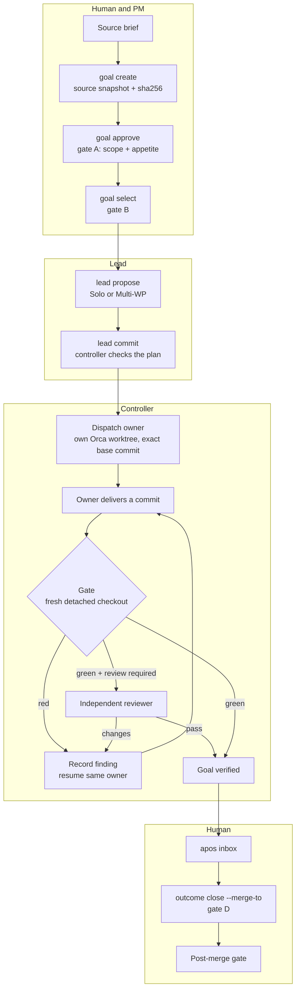

# APOS

**AI Project Orchestration System.** APOS runs AI coding agents on software Goals. A Human decides *what* to build and whether to accept it; a Lead agent decides *how*; a controller with no LLM in it dispatches the work, checks the result itself and keeps an auditable record of everything that happened.

   

---

## Contents

1. [Why APOS](#why-apos)
2. [How it works](#how-it-works)
3. [Install](#install)
4. [Quick start](#quick-start)
5. [The Goal contract](#the-goal-contract)
6. [Execution flows](#execution-flows)
7. [Web UI](#web-ui)
8. [Telemetry](#telemetry)
9. [Configuration and state](#configuration-and-state)
10. [Trust model](#trust-model)
11. [CLI reference](#cli-reference)
12. [Development](#development)
13. [Status and known limits](#status-and-known-limits)

---

## Why APOS

The design follows what the Hard12 multi-agent runs showed works:

- **One owner keeps the context** of a whole block of work. When a check fails, the controller resumes the *same* owner session instead of starting a cold one.
- **Correctness comes from a source-backed contract and a gate the controller runs itself.** An owner's report that it is done is a claim, never evidence.
- **The Human decides what and what counts as done, not how.** Technical planning belongs to the Lead and needs no Human approval.

Design notes: [`docs/FINAL-DESIGN.md`](docs/FINAL-DESIGN.md) (v2.1, in Vietnamese). Safety cases: [`docs/fault-injection.md`](docs/fault-injection.md).

## How it works

| Who | Decides | Commands |
| --- | --- | --- |
| **PM + Human** | WHAT: which Goals, outcome, acceptance, appetite (budget) | `goal create --source`, **gate A** `goal approve` |
| **Human** | Which approved Goal runs next | **gate B** `lead recommend`, `goal select` |
| **Lead** (agent) | HOW: Solo or Multi-WP, packages, interfaces. No Human approval | `lead propose`, `lead commit` |
| **Controller** (no LLM) | Machine checks, dispatch, gates, findings, retries, wake-ups, budget breakers | `controller tick` / `controller watch` |
| **Owner / Worker** (agent) | Implements in its own Orca worktree | dispatched by the controller |
| **Reviewer** (agent) | Independent review in a separate session, when required | dispatched by the controller |
| **Human** | Outcome, and whether to merge | **gate D** `outcome close [--merge-to <branch>]`, `revise`, `stop` |

When the Lead chooses Multi-WP, the controller only **notifies** the Human (`apos inbox`); it does not wait for approval.



### Human-only commands

These refuse to run from any terminal or worktree APOS dispatched an agent into, so an agent cannot approve its own work:

- `goal approve`, `goal appetite`, `goal select`
- `outcome close`, `outcome revise`, `outcome stop`
- `gate confirm`, `blocker resolve`, `execution abandon-intent`
- `review submit` (the controller dispatches and reads reviewers itself, so no agent may post a verdict)

`goal appetite` is the Human's overrun decision: it changes only the controller-held budget, never the scope.

## Install

Requirements: **Node.js 24+**, **Git**, and the **Orca CLI** with Codex enabled (the default runtime).

In `~/.codex/config.toml`, set `check_for_update_on_startup = false` (an update prompt blocks Orca workers) and `multi_agent = false` under `[features]` (owners must not spawn sub-agents).

```powershell
npm ci
npm run build
node dist/cli.js --repo C:\path\to\project init
```

`init` commits `.apos/project.yaml`, copies of the role skills under `.apos/skills/` (`apos-core` as `_core/execute.md`, plus `pm`, `lead`, `worker`, `reviewer`) and entrypoint copies under `.claude/skills/`. Briefs pin these copies by sha256, so a later change to the skills reaches a project only when `init` runs again. `init` refuses a missing skill or one written for another contract version (`apos-contract: 2`).

**Skills: two copies.** `skills/` in this repo is the stable copy and the default. The copy under development lives in the Custom-Skills repo; try it with `init --skills <dir>` or `APOS_SKILLS`. To bring it over:

```powershell
npm run skills:check   -- C:\path\to\Custom-Skills   # report differences, change nothing
npm run skills:promote -- C:\path\to\Custom-Skills   # copy into skills/, then run the tests and commit
```

`APOS_DEV_SKILLS` can replace the path argument.

## Quick start

A Solo Goal from brief to merge. `--repo` defaults to the current directory; it is omitted below.

```powershell
# 1. Capture the brief, then draft the Goal from it (see the contract below)
apos goal create --file goal.json --source brief.md

# 2. Gate A: the Human approves the Goal and sets the controller's appetite
apos goal approve GOAL-001 --size M --max-spend 20 --max-minutes 240 --max-attempts 3

# 3. Gate B: choose what runs next
apos lead recommend
apos goal select GOAL-001

# 4. The Lead proposes a plan; the controller checks it and dispatches the owner
apos lead propose --file execution.json
apos lead commit GOAL-001

# 5. Supervise (inside an Orca terminal), or run one pass at a time
apos controller watch            # or: apos controller tick

# 6. Watch from a browser, and see what needs you
apos ui                          # http://127.0.0.1:4343
apos inbox

# 7. Gate D: accept the outcome and merge the gated commit
apos outcome close GOAL-001 --merge-to main
```

A minimal `execution.json` for a Solo plan:

```json
{
  "id": "EXEC-1", "version": 1, "goalId": "GOAL-001", "goalVersion": 1,
  "mode": "solo-direct",
  "approach": "Implement slugify: lowercase, strip punctuation, split on whitespace, join with dashes",
  "risks": [], "sharedPaths": [],
  "estimatedCost": { "spendUsd": 1, "wallMinutes": 15 },
  "acceptanceMapping": [{ "acceptanceId": "AC-1", "verification": "node --test" }],
  "verificationStrategy": "Run npm test"
}
```

If a dispatch or resume outcome stays unknown for 10 minutes it appears in `apos inbox`. Check `orca orchestration task-list`; if Orca created nothing, run `apos execution abandon-intent <id> --key <key> --reason ...`.

## The Goal contract

A Goal is a strictly validated JSON document (`src/domain/contracts.ts`). A minimal valid one:

```json
{
  "id": "GOAL-001", "version": 1,
  "outcome": "slugify returns URL-safe slugs",
  "source": {
    "path": "brief.md",
    "sha256": "<sha256 of brief.md>",
    "capturedAt": "2026-11-12T08:00:00Z",
    "origin": "human"
  },
  "requirements": [
    { "id": "R-1", "sourceSpan": "line 3", "text": "slugify lowercases, drops punctuation and joins words with dashes", "disposition": "acceptance" }
  ],
  "scope": ["slugify.js"],
  "exclusions": ["no new dependencies"],
  "acceptance": [
    { "id": "AC-1", "text": "npm test passes", "requirementIds": ["R-1"], "checkIds": ["CHK-1"] }
  ],
  "checks": [
    { "id": "CHK-1", "kind": "command", "command": "npm test", "expect": "pass" }
  ],
  "dependencies": [],
  "priority": 1
}
```

- `requirements[]` lists every requirement lifted from the source, with its span and `disposition: acceptance | excluded` (an excluded one needs `exclusionReason`).
- `acceptance[]` carries `requirementIds`, `checkIds`, and optionally `examples`, `boundaries`, `prohibited` and `ambiguity` (`resolved` with a decision, or `blocked` with a question).
- `checks[]` are either `{ kind: "command", command, expect: "pass" | "no-new-failures", failurePattern?, runs, timeoutMs, env }` or `{ kind: "manual", procedure, expectedResult }`. `no-new-failures` runs base and delivery and fails only on failures that are new at delivery.

`goal create` snapshots the source with its sha256. **Approval refuses** an unmapped requirement, a `blocked` ambiguity, a missing appetite, and a source snapshot that no longer matches.

The **appetite** (`size`, `maxSpendUsd`, `maxWallMinutes`, `maxAttempts`, `overrunPolicy`) is kept only by the controller. It never appears in Goal documents or briefs.

## Execution flows

### Solo (default)

**Before dispatch** (`lead commit`), the controller checks the plan's source hash and Goal version, that there are no open questions, and that the estimate fits the appetite. For Multi-WP it also checks at least two packages, an acyclic graph, versioned interfaces (`name@vN`), acceptance coverage and a split rationale.

**Dispatch.** The owner runs in its own Orca worktree created from an exact base commit, using its role profile (default: Codex `gpt-6.1-terra` for Lead and Worker, `gpt-6-sol` for Reviewer; override in `runtime.json`). The brief points at `.apos/skills/_core/execute.md` and the role skill by path and sha256, and names the activation line the delivery report must contain.

**After the owner settles**, `controller tick`:

1. Compares the launch receipt with the requested model. A mismatch is `needs-decision`.
2. Reads the delivery head of the owner's worktree and checks that the committed report carries the activation line. If not, a finding resumes the same owner.
3. Runs the **gate**: a fresh detached worktree at that exact commit, with a tree-killing timeout, comparing base and delivery failures. Logs are hashed in the controller home.
4. **Green.** If review is required (Multi-WP, declared risks, changed tests or oracles, changed shared paths), a reviewer runs in a separate session. Otherwise the Goal is `verified` and waits for the Human.
5. **Red.** The controller records a finding (check IDs, commit, logs) and resumes the same owner in the same terminal and worktree.
6. **Stops at `needs-decision`** when the cause is unknown or the gate is unverifiable, the same failure survives two repairs, the attempt budget or wall time is spent, or the owner reports `failed`.

`outcome close --merge-to <branch>` records a one-time authorization for the gated commit and merges it, then reruns the gate on the merge commit. If that gate is red the Goal stays open.

**Manual checks** stay pending until someone other than the owner confirms them: `gate confirm GOAL-001 <checkId> --commit <sha> --by <name> --note "..."`.

**Findings** (`finding record --kind`): `intent_gap` parks the Goal for PM and the Human; `bad_plan` is for the Lead to revise; `patch` goes to the owner; `defer` goes to the backlog.

### Multi-WP

The Lead adds packages (`package add --file wp.json`). Each names its owner, dependencies, versioned interfaces and local acceptance, optionally with `checkIds` from the Goal's checks. Then the Lead runs `lead commit GOAL-001 --terminal $ORCA_TERMINAL_HANDLE`.

The controller then:

- dispatches packages as their dependencies are verified;
- gates each settled package on its own head against its base: green verifies the package, red sends it back to the same owner with the finding;
- wakes the Lead's terminal once per batch of new events (package results, owner questions, ready to integrate, a red integration gate), and only after the Lead's previous turn has settled.

`integration complete` gates the integration commit itself. Every Multi-WP Goal needs an independent Goal review before it can verify; once the integration gate is green on a commit that contains every package, the controller dispatches that reviewer itself (one per gated commit) and wakes the Lead with the verdict. A Multi-WP plan must not declare `risks`: they would demand package reviews APOS does not dispatch.

## Web UI

`apos ui [--port 4343]` serves a **read-only** web view of one project on `127.0.0.1`. It observes; it never runs the controller (start `controller watch` separately) and never writes controller state.

- **Needs you:** gate A and B waiting, `needs-decision`, notices, and verified Goals awaiting an outcome. The list matches `apos inbox`, plus the two gates the CLI does not list.
- **Goals by who holds them:** Human, Lead, Controller / agent, Done.
- **Story tab** (default per Goal): what the Human gave; what the Lead decided (mode, approach, why it split or did not, risks, verification, estimated cost against the appetite); and for each owner the decisions, checkpoints, evidence, blockers, findings and reviews it put on record.
- **Agent activity:** for each dispatch, the agent's own transcript (Codex rollouts under `~/.codex/sessions`, Claude Code sessions under `~/.claude/projects`; `CODEX_HOME` and `CLAUDE_CONFIG_DIR` move them), newest first, refreshing every 3 seconds while the owner runs: what it said, planned, ran and got back.
- **Also:** lifecycle, Work Package graph, gate results with their logs, telemetry and appetite use, and the full event timeline.

What to know before relying on it:

- **No reasoning is shown.** Both agents encrypt or blank their reasoning, so only what they wrote and did is visible. This is the agent's own account, not a verified one.
- **Transcripts are matched to a dispatch by worktree path and time**, not by an id. The page says so.
- **Secrets are hidden by pattern** (keys, tokens, `NAME_KEY=value`). That is best effort, not a guarantee, and a transcript can contain anything the agent saw.
- **There is no login.** It binds to loopback, checks the `Host` header, accepts only GET and HEAD, and resolves every request by id rather than path, but anything running as your OS user can read it. Keep it on a machine only you use.
- It reads event logs without locking, creating or rebuilding anything. A torn final line is ignored, and a Goal whose hash chain is broken is flagged while the others still show.
- Spend in USD is not shown: APOS has no price table. Tokens, attempts and wall time are.

Design: [`docs/design/apos-ui.md`](docs/design/apos-ui.md), [`docs/design/apos-ui-activity.md`](docs/design/apos-ui-activity.md).

## Telemetry

`telemetry-recorded` events hold, per dispatch and role: the requested and launched model, token usage (input, cached, output) read from the owner's Codex session files, and wall time. When nothing matches, the usage is recorded as `unknown`, never estimated. `apos metrics show <goalId>` summarizes a Goal.

## Configuration and state

Controller state lives **outside the repo**, in `~/.apos/projects/<repo>-<hash>/`:

| Path | Contents |
| --- | --- |
| `events/<GOAL>.jsonl` | Append-only, fsync'd, hash-chained event log. The source of truth. |
| `state.sqlite` | An index, rebuildable from the log. |
| `sources/<GOAL>/v<n>.md` | Verbatim source snapshots. |
| `artifacts/` | Gate logs. |
| `runtime.json` | Optional role profiles (agent, model, effort). |

The repo gets readable Goal documents (`.apos/goals/<id>/`) committed only at milestones: Goal approved, plan accepted, verified, merged, outcome. Events committed into the repo by anyone else are ignored. `apos migrate` imports APOS v1 histories that still fit the contract.

| Environment variable | Effect |
| --- | --- |
| `APOS_HOME` | Move the controller home. |
| `APOS_SKILLS` / `APOS_DEV_SKILLS` | Skills source for `init` / for `skills:check` and `skills:promote`. |
| `APOS_ARTIFACTS` | Move the gate-log folder. |
| `CODEX_HOME`, `CLAUDE_CONFIG_DIR` | Where agent transcripts are read from (UI and telemetry). |

## Trust model

The controller home is **tamper-evident**, not a security boundary against a process that runs as the same OS user. Each event carries the hash of its predecessor, so an edit to the log breaks the chain and is detected; it does not stop an agent with the same user rights from reading or deleting files. The Human-only commands rely on APOS recognizing the terminals and worktrees it dispatched, which guards against an agent acting by mistake or by prompt, not against a determined local process. APOS assumes a single host operated by a trusted developer.

## CLI reference

Global option: `--repo <path>` (managed Git project; default: the current directory).

| Command | Purpose |
| --- | --- |
| `init [--skills <dir>]` | Initialize `.apos` in a Git project. |
| `migrate` | Import APOS v1 Goal histories into the controller log. |
| `goal create --file <json> --source <path> [--origin <text>]` | Draft a Goal bound to a source snapshot. |
| `goal list` | List Goals and their status. |
| `goal approve <id> --size <S\|M\|L> --max-spend <usd> --max-minutes <n> --max-attempts <n> [--overrun <stop\|ask>]` | **Gate A (Human).** |
| `goal appetite <id> --reason <text> [appetite flags]` | **Human.** Change the controller budget, not the scope. |
| `goal select <id>` | **Gate B (Human).** |
| `goal revise --file <json> --source <path>` | New Goal version; needs re-approval. |
| `lead recommend` | Recommend the next eligible Goal. |
| `lead propose --file <json>` | Submit an execution proposal. |
| `lead commit <id> [--terminal <handle>]` | Controller checks the plan and dispatches. |
| `package add --file <json>`, `package revise <goalId> --file <json> --reason <text>` | Multi-WP packages. |
| `integration prepare <goalId>`, `integration complete <goalId> --file <json>`, `integration merge <goalId> --source <commit> --target <branch>` | Multi-WP integration: prepare, record the integration commit, merge. |
| `controller tick` | One controller pass: reconcile, gate, dispatch, wake. |
| `controller watch [--interval-ms <n>]` | Continuous loop, inside an Orca terminal (1000 to 300000 ms; default 15000). |
| `gate run <goalId> --commit <sha> [--base <sha>]` | Run the gate on a specific commit. |
| `gate confirm <goalId> <checkId> --commit <sha> --by <name> --note <text>` | **Human.** Confirm a manual check. |
| `execution checkpoint <id> --file <json>`, `execution retry <id> --reason <text>`, `execution abandon-intent <id> --key <key> --reason <text>` | Owner checkpoint, retry, and (Human) drop an unknown intent. |
| `evidence add <id> --file <json>`, `evidence show <id>` | Owner evidence. |
| `decision record <id> --note <text>`, `blocker report <id> --kind <kind> --note <text>`, `blocker resolve <id> --note <text>` | Decisions and blockers (`resolve` is Human). |
| `finding record <id> --kind <intent_gap\|bad_plan\|patch\|defer> --note <text> [--by <name>]` | Record a finding. |
| `outcome close <id> [--merge-to <branch>] [--by <name>]`, `outcome revise <id>`, `outcome stop <id>` | **Gate D (Human).** |
| `inbox` | What needs the Human: notices, blocked Goals, verified Goals awaiting an outcome. |
| `ui [--port <n>]` | Read-only local web view. |
| `metrics show <goalId>` | Tokens, attempts and wall time. |

Run `apos <command> --help` for the exact options of any command.

## Development

```powershell
npm ci
npm test              # vitest; covers every safety case in docs/fault-injection.md
npm run typecheck     # tsc --noEmit
npm run build         # tsc -> dist/
```

```text
src/
  domain/    contracts (zod), state machine (transitions), gate and Goal types
  store/     event log, journal, SQLite index, read-only journal
  app/       controller, gate, packages, review, merge, supervisor, inbox
  runtime/   Orca adapter, brief builder, telemetry probe
  ui/        read model, story, agent activity, HTTP server, single-page UI
skills/      stable role skills (apos-core, apos-pm, apos-lead, apos-worker, apos-reviewer)
docs/        FINAL-DESIGN.md, fault-injection.md, design/
scripts/     skills promotion
```

## Status and known limits

APOS has run live on real Orca with Codex (`gpt-6.1-terra`): a clean Solo Goal, a repair path (the gate went red, the same terminal was resumed, the Goal verified and merged), and a Solo Goal through independent review, repair, a second review, `verified`, closed and merged under `controller watch` with no manual step. These runs found and fixed multi-line briefs stalling in the Codex composer, an owner committing into the managed checkout, Orca timing out on a dispatch that had started, a resume refused right after `worker_done`, and telemetry double counting.

Known limits:

- **Spend is not enforced.** `maxSpendUsd` and `overrunPolicy` are recorded, but there is no price table and an overrun only notifies. The controller cannot stop a running owner; it only declines to resume it.
- **Multi-WP has run live only on a toy Goal**, not yet where packages truly depend on each other or where the review asks for changes.
- **The quality pilot did not beat the baseline.** On the SQLFMT task APOS ended with 28/32 target tests against the single-agent baseline's 32/32, and the controller blocked the Goal rather than verify it. The current aim is a smooth controller, not accuracy.
- **Solo loses the Lead's planning context.** The Solo owner is a fresh session dispatched after `lead commit`, not the session that wrote the plan.
- **Agent activity in the UI is verified against Codex dispatches.** The Claude Code reader works on real Claude Code transcripts but has not yet seen a Worker dispatched by APOS.
- **Single host, trusted user** (see the trust model).
